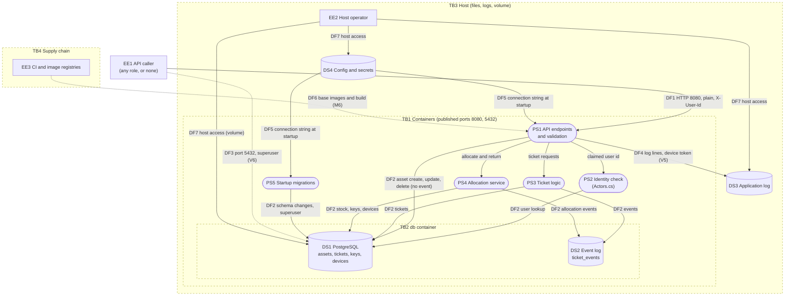

# security-analysis.md — PA2 naive baseline

## AI Deliverable Metadata Block

| Item | Detail |
|---|---|
| Conceptual AI contribution | AI: _%_ / HUMAN: _%_ (to set once sections 3–7 are written) |
| My part | Wrote the security requirements from the spec's business rules, including the review gaps, and chose to judge each on its own logic; checked every CWE against MITRE CWE 5.0; ran every test and check against the stack (`\du`, the network login, the requirement runs, the abuse case checks); decided which findings were confirmed and promoted (V4, V5, V6) and asked for M9 to be closed; asked for risk ratings and for data minimization, deny by default, the event log in the database and response headers to be explored; raised hoarding and asked to add it; decided on the renumbering; wrote AC1–AC6 and the coverage tables, and asked for AC7; caught the SR9 contradiction and proposed the fix; wrote the attack trees; found the SR11 scope gap and set out the two options, then chose to widen it; revised the attack surface map and ran the database volume check; drew the DFD and wrote the STRIDE matrix, raised the log integrity threat (G7), chose the host access scope rule, corrected G8's CWE and ran the log configuration check; wrote the mitigation plan; caught stale and broken references and the assistant overstating its part |
| AI part (Claude chat assistant) | Section skeleton; carried in the triage findings and protections; attack-surface routes read from the code; reviews of the requirements, abuse cases and attack trees against the code and evidence; test scripts and check commands; status updates from the results; V4–V6 write-ups (suggested testing the V6 chain); risk-rating scale and ratings; drafts of SR14, SR16, SR18 and SR7 (fair share); AC7 draft; renumbering; tree layout fixes; SR11 rewrite after she widened it; review of the attack surface map and the volume check command; review of the DFD and STRIDE matrix (two missing flows, host rule options, G8 draft and its correction after her check); review and corrections of the mitigation plan |
| Design-aid prompts | `.ai_logs/2026-11-15_security-analysis-log.md` (in this folder) |

## 1. Scope

- **System analyzed:** the Domain 2 Resource Allocation & Help Desk Hub in `PA2/functional-codebase/` (C#/.NET 10 minimal API, EF Core, PostgreSQL 18, Docker Compose). Code as scanned at `4d39740`; later commits change file headers and line breaks only
- **Inputs:** `spec-domain2.md`; `sast-triage-report.md` (scan results, validated vulnerabilities V1–V6, candidates, existing protections P1–P10); evidence in `evidence/`: `manual-validation-2026-11-15.txt`, `sr-validation-2026-11-15.txt`, `sr-validation-2-2026-11-15.txt`, `db-role-check-2026-11-15.txt`
- **Host access:** anyone with access to the host (its files, the database volume, the container logs, `docker` itself) is out of scope for prevention, since the application can't stop them. It stays in scope wherever the application could limit the damage: secrets readable in host files (DF7-I) and records that can be edited there (DS3-T). Threats that only a host-level control could address are marked "out of scope (host)" in the STRIDE matrix
- **In scope:** the API and its PostgreSQL database as `docker-compose.yml` runs them on one host, the image build, and the CI pipeline configuration
- **Out of scope:** what `spec-domain2.md` section 8 leaves out (calls to other Project Portal services, notifications, a user interface, expiry dates for keys and vouchers). No code is changed here; section 7 proposes changes
- **Deployment assumption:** the API and the database share one host, so their traffic stays on the compose network (DF2). If the database moves to another machine, DF2 needs encryption

### 1.1 Confirmed vulnerabilities

Validated on 2026-11-15 against the running compose stack. V1–V3 are carried in from the triage (full write-ups in `sast-triage-report.md` §4); none was flagged by Semgrep or SonarQube. V4 and V5 were confirmed while testing the security requirements in section 2 (`evidence/sr-validation-2026-11-15.txt`), and V6 by chaining three candidates (`evidence/db-role-check-2026-11-15.txt`).

| # | Vulnerability | Layer | CWE | Risk |
|---|---|---|---|---|
| V1 | Caller identity is the `X-User-Id` header, accepted as given: anyone who knows a user id can act as that user, and the event log records the impersonated user as the actor | Authentication | CWE-290 | High |
| V2 | Ticket list and detail are open to anyone and return requester ids, notes and event actor ids, which supply the ids V1 needs; together V1 and V2 give anyone administrator access | Authorization / data exposure | CWE-862 | High |
| V3 | License keys stored in plain text and returned as-is by allocate and the allocations listing | Data storage | CWE-312 | High |
| V4 | Ticket event history deleted with the ticket: deleting a pending ticket through the API removed its submission event (0 left), because events cascade-delete with their ticket (`Data/HubDbContext.cs` L114). Combined with V1, anyone can erase the record that a request was made (was G6; SR11) | Audit / database | CWE-221 (a Class; its nearest Base child, CWE-223, covers not recording an event, not deleting one already recorded) | Medium |
| V5 | Full device token written to the application log on return (`Endpoints/AssetEndpoints.cs` L77). The token is all `/return` needs, so anyone who can read the logs holds working tokens. SonarQube flagged the same line only for logging performance (CA1873, triage S1), not for the token (was M5; SR22) | Logging | CWE-532 | Medium |
| V6 | Database open to the network as superuser with the committed password: no `.env` exists, so the stack uses the compose fallback password `resourcehub_dev` (was M4, also committed in `appsettings.Development.json`); port 5432 is published on all host interfaces (was G4); and that user is a superuser (was G2). A separate container outside the compose network logged in with it and got `usesuper = t`. Full control of the data without the API: every license key (V3), the event log (SR11) and stock. Tested through the host, not from a second machine. G2 and G4 come from the PA1 compose file, not the PA2 build | Deployment / database | CWE-1392 (default password), with CWE-1327 (unrestricted bind) and CWE-250 (excess privilege); CWE-260 for the copy in the config file | High |

**How risk is rated:** impact if exploited, weighed against how easy it is to reach.
- **High:** anyone who can reach the API or the database can do it with no special access, and it exposes secrets or gives control (V1, V2, V3, V6). V6 is rated for the stack as it runs; it drops if the database port is closed in deployment
- **Medium:** real damage, but it needs some access first (log access for V5, the requester's identity or V1 for V4), or it weakens the system without being an attack on its own (M6, M7, G5)
- **Low:** little to gain on its own (M8 only repeats what V1 already allows; G3 shows counts, no keys)

### 1.2 Candidates not yet confirmed

From the triage review and my design-time notes. CWE ids checked against MITRE CWE 5.0 (released 2026-10-28) on 2026-11-15.

| # | Candidate | Where | CWE | Risk |
|---|---|---|---|---|
| M6 | Floating image and runner tags (`sdk:10.0`, `aspnet:10.0`, `postgres:18`, `ubuntu-latest`) | `Dockerfile`, `docker-compose.yml`, `devsecops.yml` | CWE-494 (secondary: CWE-1357) | Medium |
| M7 | Plain HTTP on 8080; header and keys travel unencrypted | `Dockerfile`, `docker-compose.yml` | CWE-319 | Medium |
| M8 | 401 message tells the caller how to get through ("Send the id of a known user in the X-User-Id header.") | `Services/Actors.cs` L31 | CWE-210 | Low |
| G3 | Asset list and detail open to anyone (counts only, no keys) | `Endpoints/AssetEndpoints.cs` | CWE-862 (low) | Low |
| G5 | No rate limiting: nothing in the source configures a rate limiter, and 60 fast requests all got 200 (carried from my PA1 notes, confirmed 2026-11-15, `evidence/sr-validation-2026-11-15.txt`, SR22) | all endpoints | CWE-770 | Medium |
| G7 | Application log has no integrity protection: anyone with host access can edit or remove lines, and it's the only record of returns and asset changes (from the STRIDE review, not tested) | container log (DS3) | no clean CWE fit; nearest is CWE-221 (Class). The attack pattern is CAPEC-268, Audit Log Manipulation | Low |
| G8 | Application log keeps only what the host's log settings allow: `docker-compose.yml` sets nothing, so the host decides. On this host (Docker Desktop) it's the `local` driver with its defaults, about 100 MB per container, oldest lines dropped first; a flood of requests (G5) can push out the only record of returns and asset changes (SR11). On a Docker Engine host with the `json-file` default and no limits, it would instead grow without bound (`evidence/abuse-case-checks-2026-11-15.txt`, check 4) | `docker-compose.yml`, container log (DS3) | CWE-779 (Logging of Excessive Data) | Low |

**Reviewed, not a finding:** G1, `AllowedHosts: "*"` in `appsettings.json`. It's the ASP.NET template default, and nothing in the code reads the Host header or builds a link or redirect from it, so there's nothing to exploit here.

**Reviewed, not a finding:** M9, possible missing null checks in `Services/AssetViews.cs`. Every nullable stock and balance value is read with a default (`?? 0`, L58–L74), and the database has check constraints that keep stock and balances within range (`Data/HubDbContext.cs` L72–75), so there's no null to dereference.

## 2. Security requirements (defensive baseline)

Each requirement says what the system must guarantee, whatever the current code does. The findings are the evidence of whether it is met. Group A comes from the business rules in `spec-domain2.md`, reshaped to hold even when someone is trying to break them, plus one gap I found in review (SR10), and follows a ticket's journey from request to return. Group B covers the controls everything else depends on, ordered by layer; the spec leaves security out on purpose, so their sources are the assets they protect.

Each requirement is judged on its own logic, assuming the requirements it depends on hold; a failed dependency (most often SR12, through V1) is carried by the "Depends on" line, not repeated in every status.

**Read SR12 first.** Authentication is listed in group B with the other cross-cutting controls, but almost every other requirement depends on it.

**Numbering:** renumbered on 2026-11-15 to group the requirements by topic. The two evidence runs label their steps with the earlier numbers, so where a status cites "`evidence/sr-validation-2026-11-15.txt`, SRn", SRn is that run's step label. Earlier → current: 7→8, 8→9, 9→10, 10→11, 11→12, 12→13, 13→15, 14→17, 15→19, 16→20, 17→21, 18→22, 19→23, 20→24, 21→25, 22→26, 23→16, 24→14, 25→18, 26→7 (1–6 unchanged).

Status values: **Met (tested)**, **Met (review)** (read in the code, not yet run), **Partly met**, **Not met**, **Not checked**, each with its evidence (a V, M, G or P id, a code location, or a test).

### 2.1 Group A: business rules

#### A1 Requests and approval

**SR1 — Authorization: request scope.** A course instructor shall be able to submit tickets only for a course they teach, and a research lab faculty advisor only for their own lab.
- Source: spec clarification 7, roles in section 4, mock users in section 7
- Depends on: SR12
- How to verify: as the CS501 instructor, submit a ticket for EE580
- Status: **Met (tested).** Dr. Chen submitting for EE580 got a 403 (`evidence/sr-validation-2026-11-15.txt`, SR1). Enforced in `Services/TicketContent.cs` L129–135. SR13 is the general form of this rule

**SR2 — Integrity: ticket state machine.** The server shall allow only these transitions, each by its role: pending → approved or rejected (IT director), approved → allocated (administrator, through allocate only), allocated → closed (administrator). Content changes and deletes shall be allowed only while the ticket is pending. A ticket shall be allocated at most once, and any other transition shall be rejected and logged as SR11 describes.
- Source: spec requirement 3, clarification 8
- Depends on: SR12
- How to verify: allocate a rejected ticket; allocate the same ticket twice; edit an approved ticket
- Status: **Partly met.** Tested: editing an approved ticket got a 409, a wrong-role approval a 403, and a second allocate a 409 (`evidence/sr-validation-2026-11-15.txt`, SR2 and SR3). Not met: the refused approval left no event (only the submission event is in `ticket_events`) and nothing in the application log (SR22). Only failed allocations are recorded (`Services/AllocationService.cs` L52, L65). In practice the role checks also fail through SR12 (V1)

#### A2 Allocation

**SR3 — Integrity: all-or-nothing allocation.** An allocation shall either complete fully (stock and balances reduced, keys and tokens issued, allocation recorded) or change nothing, leaving the ticket approved. Each license key shall be issued to at most one allocation.
- Source: spec requirement 4, clarifications 9, 10
- How to verify: existing concurrent allocation test (P7); an allocation where one requested asset is short
- Status: **Met (tested).** A second allocate of the same ticket got a 409 (`evidence/sr-validation-2026-11-15.txt`, SR3). One key per allocation: allocate takes only unissued keys while holding a lock on the asset row (`Services/AllocationService.cs` L120); the key table shows each issued key on one ticket and allocation. This run didn't make two allocations compete for the same keys, so that part rests on the code review and the P7 test

**SR4 — Integrity: voucher balance.** At allocation, the server shall reject any deduction that would take a voucher balance below zero, including when two allocations arrive at the same time. The check and the deduction shall happen in one transaction, and a rejected attempt shall be logged as SR11 describes.
- Source: spec requirement 2, clarification 4
- Depends on: SR12 (who can run allocate)
- How to verify: two concurrent allocations that together exceed the balance; one succeeds, one is rejected, balance never below zero
- Status: **Met (tested).** Two simultaneous allocations of 3000.00 against a balance of 5000.00: one 200, one 409 with the shortfall, balance left at 2000.00 (`evidence/sr-validation-2026-11-15.txt`, SR4)

**SR5 — Integrity: single path to remaining stock.** Remaining stock and balances shall never go negative or above total. Apart from the recalculation when total stock changes, they shall change only through allocate (decrease) and return (increase), and only when run by an authenticated administrator. Changing total stock through `PUT /api/v1/assets/{asset_id}` shall never leave remaining stock negative or above total.
- Source: spec requirement 4, clarification 4
- Depends on: SR12
- How to verify: lower total stock below what is already handed out, then read the asset
- Status: **Met (tested).** Lowering laptop total stock to 1 with 2 out got a 409 (`evidence/sr-validation-2026-11-15.txt`, SR5). The code also refuses lowering a voucher total below what is used and removing issued keys (`Endpoints/AssetEndpoints.cs` L259–263, L278–282); those two weren't run

**SR6 — Accountability: issued secrets recorded.** The service shall record which license key or hardware token went to which ticket and when. Keeping the values themselves out of the application log is SR22.
- Source: spec requirement 2 ("log high-value alphanumeric license tokens"), clarification 5
- How to verify: allocate, then query the issued keys and devices for the ticket id and time
- Status: **Met (tested).** The issued key shows its ticket, allocation and issue time, and each device its ticket and check-out time (`evidence/sr-validation-2026-11-15.txt`, SR3 / SR6). The spec wording asks for the tokens to be logged, which reads as the weakness itself; I took clarification 5 as the safe reading, recording the issuance and not the value

**SR7 — Availability: fair share of stock.** One requester, or one department program, shall not be able to tie up a disproportionate share of an asset through the normal request flow. Limits on quantity per ticket, loan length and open tickets per requester or department shall be set by policy and enforced by the server, not left to the approver alone.
- Source: the hoarding abuse case (section 3). The spec sets no such limits, so the actual numbers are a policy decision; this requirement only says they must exist and be enforced
- Depends on: SR12 (otherwise a limit per requester means nothing)
- How to verify: as one instructor, ask for more than the stock on a 365-day loan, and open several tickets; expect a refusal past the limit
- Status: **Not met** (tested). Dr. Chen's ticket for 1000 Raspberry Pi kits (stock 10) on a 365-day loan plus all three license keys was accepted (201) while she had other tickets pending; the probe ticket was then deleted (`evidence/sr-validation-2-2026-11-15.txt`). The only caps are per ticket (20 items, 1000 each, 365 days), not per requester or department

#### A3 Devices and returns

**SR8 — Integrity: status flags and due dates.** The server shall work out each device's status (available, reserved, checkedout, overdue) and due date from the allocation date and loan period. A caller shall not be able to set either directly.
- Source: spec requirement 2, clarification 6
- How to verify: send a status or due date in an update body and check that it is ignored or rejected
- Status: **Met (tested).** An update carrying `status: overdue` and `remainingStock: 999` returned 200 with remaining stock unchanged at 3 and the device status unchanged (`evidence/sr-validation-2026-11-15.txt`, SR7 / SR16). The extra fields are silently ignored, not rejected. SR20 is the general form of this rule

**SR9 — Integrity: returns.** A hardware assignment token shall be accepted for return only while its device is checked out, and only once. A return shall never push remaining stock above total.
- Source: spec clarifications 6, 11
- Depends on: SR12
- How to verify: return the same token twice; return a made-up token
- Status: **Met (tested).** Returning a token got a 200, the same token again a 409, and a made-up token a 404 (`evidence/sr-validation-2026-11-15.txt`, SR8)

#### A4 Catalog and records

**SR10 — Integrity: asset deletion.** The server shall reject deleting an asset that any ticket or allocation refers to, so active allocations, issued keys and tokens, and their history stay intact.
- Source: a gap I found in review, not from the spec. The spec allows `DELETE /api/v1/assets/{asset_id}` but doesn't say what happens to an asset that is in use, so this is my own clarification
- Depends on: SR12 (only an administrator can delete)
- How to verify: delete an asset with a checked-out device or an issued key and expect a 409; delete an unused asset and expect a 204
- Status: **Met (tested).** Deleting the laptop while in use got a 409; an unused asset was deleted with a 204 (`evidence/sr-validation-2026-11-15.txt`, SR9). The agent added this without being asked (P10)

**SR11 — Accountability: trustworthy event log.** Every change to tickets, stock and devices shall be recorded with the verified identity of the caller who made it, the time and the outcome: ticket submissions, edits and state changes, every allocation attempt (failed ones included), device returns, and creating, updating or deleting an asset. The log shall be append-only, both through the API and in the database: the service's database user can add events but not change or delete them. Other requirements that say "logged" mean this.
- Source: spec requirement 3 and clarification 13, which cover tickets and allocation attempts. I widened it to returns and asset changes because those change stock and devices just as much, and AC4 and AC7 rely on them leaving no record
- Depends on: SR12
- How to verify: make a change, read the ticket's events, check the actor; return a device and change an asset, then look for an event; try to edit or delete an event through the API and in the database
- Status: **Not met**, for three separate reasons:
  - **Scope:** returns and asset create, update and delete record no event, only an application log line. There's no event type for them (`TicketEventType` in `Domain/Entities.cs` has only Submitted, Updated, Approved, Rejected, AllocationSucceeded, AllocationFailed, Closed), and events are written only in `Endpoints/TicketEndpoints.cs` (L97, L168, L297) and `Services/AllocationService.cs` (L52, L65, L149). Met (review) for what clarification 13 asks: ticket changes and allocation attempts are recorded with actor and time
  - **Append-only through the API:** deleting pending ticket T3 removed its submission event from `ticket_events` (V4; 0 left; `evidence/sr-validation-2026-11-15.txt`, SR10), because events cascade-delete with their ticket (`Data/HubDbContext.cs` L114)
  - **Append-only in the database:** through V6, deleting 6 events succeeded inside a transaction that was then rolled back (`evidence/sr-validation-2-2026-11-15.txt`). The update in the same test matched no rows because it used an event type that doesn't exist (`Allocated` instead of `AllocationSucceeded`), so only deletion is shown

  The actor is also only as trustworthy as SR12, which fails (V1)

**Gaps found in review, to decide later.** These aren't from the spec. Most came from asking whether everything the service hands out has a way to close, return or end. They are business-process gaps more than security requirements, but a record that never closes is also an audit and availability problem, so I'm keeping them here to decide on:
- **Lost devices:** a physical device that never comes back stays overdue forever. There's no way to write it off and adjust total stock
- **Leaked license keys:** an issued key is never returned to the pool, and expiry is out of scope (spec section 8), but there's also no way to revoke or replace a key if it leaks (V3). Revocation is a different thing from expiry, so this one leans toward a security requirement
- **Approved tickets that can't be filled:** a ticket short on stock stays approved so allocation can run later (clarification 9), but clarification 8 gives no way to cancel or close it, so it can stay approved forever
- **Separation of duties:** the user who submits a ticket shouldn't be the one who approves it. The spec doesn't ask for it and no mock user holds two roles, so nothing can break it today. I'm keeping it here rather than as a requirement with a status. The wider version is that an administrator can allocate, return and delete with no second person involved (AC7)
- **Returns trust the token alone:** a return is accepted for any valid token sent by an administrator, with nothing confirming the device came back. SR9 makes each token work only once, but doesn't cover this (AC4, AC7)

### 2.2 Group B: cross-cutting controls

#### B1 Identity and access

**SR12 — Authentication.** Every request other than health shall carry proof of identity that the caller can't forge and that expires. A header value the caller picks doesn't count.
- Source: spec section 4 roles; every role rule in group A depends on knowing who the caller is
- How to verify: send a request with another user's id and no other proof; send an expired proof
- Status: **Not met** (V1). The `X-User-Id` header also never expires, so even a caller who got it legitimately keeps it forever

**SR13 — Authorization: by role and by object on every route.** SR1 is the create-time case of this rule. Every route shall check both the caller's role and whether the record belongs to them: a requester sees and changes only their own tickets, and allocations are shown only to the course's instructor, the lab's advisor, the IT director or an administrator. Reads are covered as well as writes.
- Source: protects ticket contents and user ids (V2), the asset catalog (G3) and allocations (P5)
- Depends on: SR12
- How to verify: with no header, and as a different requester, read and edit someone else's ticket
- Status: **Not met.** Ticket reads are open to anyone (V2) and asset reads too (G3). Writes and the allocations listing have role and ownership checks (P1, P5), but they rest on V1

**SR14 — Authorization: deny by default.** A route shall be closed to every caller until it has an explicit caller rule. Only the health check is public on purpose.
- Source: V2 and G3 exist because reads were left open; nothing makes a new route closed by default
- Depends on: SR12
- How to verify: call every route with no header and list which ones answer
- Status: **Not met** (tested). With no header, five read routes answered 200: health (intended), asset list and detail (G3), ticket list and detail (V2); only the allocations listing refused (401) (`evidence/sr-validation-2-2026-11-15.txt`). Caller rules are added route by route (`Actors.RequireAsync`), with no default policy

#### B2 Protecting data

**SR15 — Confidentiality: license keys and tokens.** License keys and hardware tokens shall be protected at rest, so a database read doesn't expose them, and returned only to callers SR13 allows.
- Source: protects license keys and hardware tokens, the highest-value data in the service
- Depends on: SR12, SR13
- How to verify: query the `license_keys` table directly; search the database volume's files on the host for a known key (`docker-compose.yml` L11, L31; section 5.2); read allocations as a caller who shouldn't see them
- Status: **Not met.** Keys are stored and returned in plain text (V3), and anyone using V1 can read them. Reading the database volume's files directly found a known key in two table data files and in the write-ahead log (`evidence/abuse-case-checks-2026-11-15.txt`, check 3), so the keys are exposed at rest even without the port or a password

**SR16 — Confidentiality: data minimization.** Each response shall carry only what that caller needs for that route. User ids of other people, notes and event actor ids shall not be returned to callers who don't need them, and secrets (SR15) only on the routes that issue them.
- Source: V2 shows that even a correct authorization check (SR13) leaves this open: the ticket responses hand out the ids that V1 needs
- Depends on: SR13
- How to verify: read a ticket and the ticket list and list every user id in the response
- Status: **Not met** (tested; V2). With no header, one ticket's events handed out the ids of the requester, the IT director and the administrator (`evidence/sr-validation-2-2026-11-15.txt`), exactly the ids V1 needs

**SR17 — Confidentiality: transport.** All traffic to the API shall be encrypted in transit, so the identity proof, license keys and tokens can't be read on the network.
- Source: protects the identity proof (SR12) and the secrets in SR15 while they travel
- How to verify: call the API over plain HTTP and check it's refused or redirected
- Status: **Not met.** The API serves plain HTTP on 8080 (M7)

**SR18 — Response headers.** Responses that carry secrets shall tell clients and proxies not to store them, and every response shall declare its content type and stop the client guessing it.
- Source: protects the keys and tokens in SR15 after they leave the API
- How to verify: read the headers on the allocate and allocations responses
- Status: **Not met** (tested). The allocations listing, which returns license keys and device tokens, came back with only `Content-Type`, `Date`, `Server: Kestrel` and `Transfer-Encoding`: no `Cache-Control: no-store` and no `X-Content-Type-Options: nosniff`, and the `Server` header names the web server (`evidence/sr-validation-2-2026-11-15.txt`)

#### B3 Input

**SR19 — Input handling.** Every request body, query value and route id shall be checked on the server before use, and database queries shall stay parameterized.
- Source: protects data integrity and the database
- How to verify: existing validation tests; send malformed bodies and SQL-like strings in filters
- Status: **Met (tested).** Broken JSON, wrong types, a negative quantity, over-long notes, an unknown status, an empty body and a non-GUID route id all got 400 or 404, and a text body 415; none returned a stack trace (`evidence/sr-validation-2-2026-11-15.txt`). Search text containing `%`, `_` or `' OR 1=1--` matched nothing, so it isn't treated as a pattern or as SQL. Body validation also has tests (P4), and queries are parameterized (P7)

**SR20 — Request binding.** A request body shall only be able to set the fields that route is meant to change, never stock, actor ids or server-worked-out values. SR8 is the device case of this rule.
- Source: protects server-owned fields
- How to verify: add `remainingUnits` or `requesterId` to an update body and check they're ignored or rejected
- Status: **Met (tested).** A ticket submitted with `requesterId` set to the administrator was saved with Dr. Chen as requester, and extra fields on an asset update changed nothing (`evidence/sr-validation-2026-11-15.txt`, SR16 and SR7 / SR16). Bodies bind to fixed request types, and unknown fields are silently ignored rather than rejected. `TicketRequest`'s `Status` field is how the transitions in SR2 are requested, so it's meant to be there

#### B4 Errors and logging

**SR21 — Error messages.** Errors shall tell the caller what went wrong without revealing internals, other users' data or how to get past a check.
- Source: keeps error responses from helping an attacker
- How to verify: trigger 400, 401, 403, 404, 409 and a server error, and read each body
- Status: **Partly met.** Every malformed request above came back as problem details with no stack trace (P9; `evidence/sr-validation-2-2026-11-15.txt`), but the 401 tells the caller exactly which header to send (M8, shown again in the same run)

**SR22 — Security logging.** Refused and failed attempts (401, 403, 409) shall be written to the application log with the caller, route and time, and no key, token or password value shall ever be written there. This is separate from the business event log in SR11.
- Source: lets someone notice an attack and work out what happened afterwards
- How to verify: make refused calls and read the log; search the log for key and token values
- Status: **Not met** (tested). The returned device token is in the application log in full (V5), and none of the refused requests in the run (two 403s, 409s) appear in the log at all (`evidence/sr-validation-2026-11-15.txt`, SR18). The identity check (`Services/Actors.cs`) has no logging

#### B5 Platform

**SR23 — Secrets management.** No password, key or other secret shall be committed to the repository or used as a built-in default. Secrets shall be supplied at deployment and the service shall refuse to start without them.
- Source: protects the database credentials
- How to verify: search the repository for the database password; start the stack without `POSTGRES_PASSWORD` set
- Status: **Not met** (V6). The password is committed in `appsettings.Development.json` and is the compose fallback (M4)

**SR24 — Least privilege.** The API's database user shall have only the rights it needs on its own tables, and shall not be able to change the schema or manage roles. The database shall be reachable only by the API, not from the host's network.
- Source: limits the damage if the API or its connection is compromised
- How to verify: `\du` for the app user's role; connect to port 5432 from another machine on the network
- Status: **Not met** (V6). The app user is a superuser (G2, confirmed with `\du`, `evidence/db-role-check-2026-11-15.txt`) and port 5432 is published on all host interfaces (G4)

**SR25 — Build and supply chain integrity.** Base images shall be pinned by digest and the CI runner to a fixed version, dependencies locked and scanned, and pipeline actions pinned.
- Source: protects what gets built and deployed
- How to verify: read the `Dockerfile`, `docker-compose.yml` and `devsecops.yml` for floating tags; check the Trivy results
- Status: **Partly met.** Lock files, Trivy scans and pinned action and scanner versions are in place from PA1, but the base images and runner are floating tags (M6)

**SR26 — Availability: limits.** The service shall limit how many requests a caller can make in a period and how much one request can ask for, so one caller can't exhaust it.
- Source: keeps the service usable for everyone else
- How to verify: send requests in a fast loop and watch for 429s; ask for a page size over 100
- Status: **Partly met.** Request size is limited: a page size of 500 was refused with a 400 ("Must be between 1 and 100"; `evidence/sr-validation-2026-11-15.txt`, follow-up) (P8). No rate limiting: 60 fast requests all got 200, no 429 (`evidence/sr-validation-2026-11-15.txt`, SR22), and nothing in the source configures a rate limiter (G5)

**Considered, not applicable now:**
- **CSRF and CORS:** there's no browser client and no cookies, so neither applies yet. They come back if the identity proof ever moves into a cookie
- **Container hardening:** the PA1 Dockerfile already runs the API as a non-root user. A read-only filesystem would be the next step, but that's a choice for the hardening phase

## 3. Abuse cases

Each case is told from the attacker's side, using the findings in section 1 and the requirements in section 2. I kept seven cases, drawn from five kinds of attacker (an outsider, a legitimate requester, a trusted administrator, someone with log access, anyone who can reach the database port); some attackers appear in more than one case. Together they break every requirement group except input handling, which held up in testing, and devices and returns, where the cases use a gap the requirements don't cover rather than breaking one. "Shown" records what I demonstrated: **Demonstrated** (run end to end), **Partly demonstrated** (steps shown separately) or **Not demonstrated**.

### AC1 — Steal license keys
- **Attacker:** an outsider on the network with no account
- **Goal:** working license keys to use or sell
- **Preconditions:** network access to port 8080 (or 5432 for the database route)
- **Steps:**
  1. Call any protected route; the 401 says which header to send (M8)
  2. Read any ticket with no header and copy the administrator's id from its events (V2)
  3. Send that id as `X-User-Id` and read the allocations listing (V1)
  4. Take the license keys from the response, in plain text (V3)
  5. Or skip the API: log in to PostgreSQL with the fallback password and read `license_keys` as superuser (V6)
- **Weaknesses used:** V1, V2, V3, V6, M8 (M7 if the traffic is read on the network)
- **Requirements broken:** SR12, SR13, SR14, SR15, SR16, SR21; SR17 if the traffic is read on the network; SR23 and SR24 on the database route
- **Impact:** paid licenses lost, and there's no way to revoke or replace an issued key (gaps note in section 2), so they stay lost
- **Risk:** High
- **Shown:** demonstrated through the API. The administrator's id came from an open ticket read (triage evidence, step 4), and acting as the administrator, the allocations listing returned the license key and a device token in plain text (`evidence/abuse-case-checks-2026-11-15.txt`, check 1). The database route is shown in parts: the superuser login from outside the compose network (V6) and the keys readable in the database (V3, step 5)

### AC2 — Approve your own request
- **Attacker:** a legitimate course instructor or lab advisor
- **Goal:** get their own ticket approved and allocated without the IT director's sign-off
- **Preconditions:** a real requester role, and the IT director's and administrator's ids (from a ticket's events, V2)
- **Steps:**
  1. Submit a ticket normally
  2. Send the approval with the IT director's id as `X-User-Id` (V1)
  3. Send the allocate with the administrator's id (V1)
  4. Collect the keys, credit or devices
- **Weaknesses used:** V1, V2
- **Requirements broken:** SR2, SR11, SR12, SR14, SR16
- **Impact:** the sign-off the whole spec is built around stops meaning anything, and the event log names the IT director and the administrator as the ones who did it
- **Risk:** High
- **Shown:** demonstrated. The triage evidence is this attack end to end: Dr. Chen submits (step 1), I send the approval with the IT director's id (step 2) and the allocate with the administrator's id (step 3), and the event log names them, not me (step 4). The server can't tell those requests from the real people's

### AC3 — Cover your tracks
- **Attacker:** an insider or outsider who has already done something they don't want traced
- **Goal:** remove or falsify the record of what happened
- **Preconditions:** a pending ticket to delete, or access to port 5432
- **Steps:**
  1. Probe first: refused requests aren't written to the application log (SR22), so trying things leaves nothing behind
  2. Act under someone else's id (V1), so the event log names the wrong person
  3. Delete the pending ticket through the API, which deletes its events with it (V4)
  4. Or delete event rows directly in the database as superuser (V6)
- **Weaknesses used:** V1, V4, V6
- **Requirements broken:** SR11, SR12, SR22, SR24
- **Impact:** no trustworthy answer to "who did this", which weakens every other finding after the fact
- **Risk:** High
- **Shown:** partly demonstrated; each step was shown separately, but I didn't delete someone else's ticket while acting as them. Deleting a pending ticket left 0 events (V4), deleting 6 events through the database succeeded before the rollback (`evidence/sr-validation-2-2026-11-15.txt`), the log records the impersonated actor (triage evidence, step 4), and refused requests don't appear in the application log (SR22)

### AC4 — Fake a device return
- **Attacker:** an outsider acting as the administrator, or someone with read access to the application logs
- **Goal:** make a device that is still out look returned, to hide a missing device or free the stock
- **Preconditions:** a device token, and the administrator's id (V2)
- **Steps:**
  1. Get a token: from the allocations listing while acting as the administrator (V1), or from the application log, which holds every returned token in full (V5)
  2. Send it to `/return` as the administrator (V1); the token is all the route needs
  3. The stock count goes up and the device drops off the overdue list while it is still out
- **Weaknesses used:** V1, V2, V5
- **Gaps used:** returns trust the token alone (gaps note in section 2). SR9 holds as written, since each token is accepted once, but nothing checks the device actually came back
- **Requirements broken:** SR11 (the return records no event), SR12, SR13, SR15, SR22
- **Impact:** inventory that doesn't match reality, and a lost or stolen device that never shows as overdue
- **Risk:** Medium
- **Shown:** partly demonstrated. The allocations listing returns device tokens (`evidence/abuse-case-checks-2026-11-15.txt`, check 1), the token is in the log (V5), and a token returns with a 200 (`evidence/sr-validation-2026-11-15.txt`, SR8); I didn't return a device I knew was still out

### AC5 — Rewrite inventory directly
- **Attacker:** anyone who can reach port 5432 on the host
- **Goal:** change stock, balances or records without going through the API
- **Preconditions:** network access to the host; nothing else, since the password is the committed fallback
- **Steps:**
  1. Log in to PostgreSQL with `resourcehub_dev` (V6)
  2. Update stock in `assets` or the voucher balance directly
  3. Every rule the API enforces (SR3, SR4, SR5, SR8, SR10) lives in the application, so none of them apply. The database's check constraints still keep stock and balances in range (`Data/HubDbContext.cs` L72–75), but a superuser can drop them
- **Weaknesses used:** V6
- **Requirements broken:** SR4, SR5, SR11, SR23, SR24
- **Impact:** inventory and balances can't be trusted, and nothing records the change
- **Risk:** High
- **Shown:** demonstrated. The superuser login from outside the compose network (V6), then through the same login an update setting the Raspberry Pi kit's remaining stock to 0 succeeded (`UPDATE 1`) before it was rolled back (`evidence/abuse-case-checks-2026-11-15.txt`, check 2)

### AC6 — Hoard stock (insider misuse)
- **Attacker:** a legitimate instructor or advisor, or a group of them in one department program
- **Goal:** tie up stock other courses and labs need, through the normal request flow
- **Preconditions:** a real requester role; nothing else
- **Steps:**
  1. Request the maximum: 20 items, up to 1000 each, on a 365-day loan
  2. Keep several tickets open at once; nothing limits one requester's or one department's share
  3. Rely on volume to wear down the IT director's approval, the only gate (or skip it through V1)
  4. Never return the devices, since an overdue device can't be written off; or drain the license keys or the voucher balance
- **Weaknesses used:** no limit per requester or department (SR7; CWE-770)
- **Requirements broken:** SR7
- **Impact:** availability for everyone else, through something no one would call an attack
- **Risk:** Medium
- **Shown:** demonstrated. A request for 1000 kits against a stock of 10, on a 365-day loan, plus all three license keys, was accepted with a 201 while the same requester had other tickets pending (`evidence/sr-validation-2-2026-11-15.txt`)

### AC7 — Misuse a real administrator role (privileged insider)
- **Attacker:** a real administrator, using only the access the role gives; no V1 needed
- **Goal:** take resources for themselves or a friend, and make it look like routine work
- **Preconditions:** the administrator role
- **Steps:**
  1. Allocate an approved ticket; the allocate response hands the administrator every key and device token issued (SR15 allows it: the role needs to run allocate)
  2. Keep a device and mark it returned with its token; the return route checks only the token, so stock goes up and the device is never overdue (as in AC4, but with no impersonation)
  3. Delete other requesters' pending tickets they don't want filled; an administrator can delete any pending ticket, and its history goes with it (V4)
  4. Change total stock through `PUT /api/v1/assets/{id}` to make the numbers fit
- **Weaknesses used:** V4
- **Gaps used:** no separation of duties or second approval for allocation, returns or deletes, and returns trust the token alone (both in the gaps note in section 2)
- **Requirements broken:** SR11 (the event log is the only check on the administrator, and it can be emptied)
- **Impact:** a trusted role can take stock and remove the trail with no other person involved, so the controls that hold against outsiders (SR1, SR3, SR10) don't help here
- **Risk:** Medium: it needs a trusted role, but nothing in the system would catch it
- **Shown:** partly demonstrated. The administrator received the keys and tokens on allocate and returned a device with its token (`evidence/sr-validation-2026-11-15.txt`, SR3 and SR8); the code lets an administrator delete any pending ticket (`Endpoints/TicketEndpoints.cs` L192); deleting a pending ticket removed its events (V4). I didn't delete another requester's ticket as the administrator

**Left out:** flooding the API (G5) and a poisoned base image (M6). Both are real, but they're generic to any service rather than shaped by this one, and the second is from review only. They stay as findings and are picked up in the STRIDE matrix.

### 3.1 Coverage check

| Finding | Abuse cases |
|---|---|
| V1 | AC1, AC2, AC3, AC4 |
| V2 | AC1, AC2, AC4 |
| V3 | AC1 |
| V4 | AC3, AC7 |
| V5 | AC4 |
| V6 | AC1, AC3, AC5 |
| M7, M8 | AC1 |
| M6, G5 | none (left out above) |

Every High-risk finding (V1, V2, V3, V6) appears in at least one case.

| Requirement group | Broken by |
|---|---|
| A1 Requests and approval | AC2 (SR2) |
| A2 Allocation | AC5 (SR4, SR5), AC6 (SR7) |
| A3 Devices and returns | none broken; AC4 and AC7 use the token-only return gap instead |
| A4 Catalog and records | AC2, AC3, AC4, AC5, AC7 (SR11) |
| B1 Identity and access | AC1, AC2, AC3, AC4 |
| B2 Protecting data | AC1, AC2, AC4 |
| B3 Input | none; held up in testing |
| B4 Errors and logging | AC1 (SR21), AC3, AC4 (SR22) |
| B5 Platform | AC1, AC3, AC5 (SR23, SR24) |

**What this shows:** the requirements that tested as met (SR1, SR3–SR6, SR8–SR10, SR19, SR20) aren't broken by any case through the API, but AC5's database route goes around all of them, because they live in the application and V6 skips the application.

## 4. Attack trees

Three trees, one each for AC1, AC2 and AC3. Each root is the attacker's goal from the abuse case; each branch is one way to get there.

**How to read them:**
- **[OR]**: any one child is enough. **[AND]**: every child is needed
- Each leaf is a concrete action tied to a finding, with three tags: **Shown** (D demonstrated, P partly, N not, as in section 3) · **Effort** (Low, Med, High) · **Needs** (none, a role, log access, network access)
- **Needs** counts only what's beyond reaching the API on port 8080, which every attack assumes. "network" means a further foothold: the database port, or a position on the path between a client and the API
- **→ cheapest path** marks the route an attacker would most likely take
- **[see T0]** points to the shared subtree below instead of repeating it

### T0 — Shared subtree: act as a privileged user

Used by all three trees. It covers acting as someone inside the API; reaching the database directly (V6) goes around the API, so each tree has it as its own branch.

```
Act as a privileged user: IT director or administrator [OR]
├── Impersonate them [AND]                                            → cheapest path
│   ├── Learn the target's id [OR]
│   │   ├── Read any ticket with no header (V2)                       D · Low  · none
│   │   └── Use the fixed seeded ids (spec section 7, …0005, …0006)   D · Low  · none
│   └── Send the id as X-User-Id (V1)                                 D · Low  · none
└── Have a real one act for me [OR]
    ├── Be one: misuse my own real role (AC7)                         P · —    · role
    └── Get one to go along knowingly (collusion)                     N · High · none
```

The seeded ids are published in the spec and used unchanged by the running stack; every test in the evidence files sent them without first reading a ticket, so V1 works even if V2 is fixed.

### 4.1 Attack tree: AC1 — Steal license keys

```
Steal license keys [OR]
├── From the API [AND]                                               → cheapest path
│   ├── Act as the administrator [see T0]
│   └── Read the keys in plain text (V3) [OR]
│       ├── The allocations listing returns them                     D · Low  · none
│       └── Allocate an approved ticket; the response returns them   D · Low  · none
├── From the database [AND]
│   ├── Reach port 5432 on the host (G4, part of V6)                 D · Low  · network
│   ├── Log in with the fallback password (V6)                       D · Low  · none
│   └── Read license_keys, stored in plain text (V3)                 D · Low  · none
└── From the network [AND]
    ├── Sit on the path between a client and the API (M7)            N · Med  · network
    └── Capture a plain-HTTP response that carries keys (M7)         N · Med  · network
```

### 4.2 Attack tree: AC2 — Approve your own request

```
Get my own ticket approved and allocated without a real review by the IT director [AND]
├── Submit my own ticket                                         D · Low  · role
├── Get it approved [OR]
│   ├── Act as the IT director [see T0]                          → cheapest path
│   └── A real IT director approves it without looking,
│       worn down by volume (as in AC6)                          N · Med  · none
└── Get it allocated [OR]
    ├── Act as the administrator [see T0]
    └── Wait: once approved, a real administrator allocates it   → cheapest path
        as routine, and nothing marks it as unusual              N · Low  · none
```

T0's "Be one" branch doesn't apply here: a requester can't also be the IT director or the administrator.

Waiting is marked as the cheapest way to get the allocation: once a ticket is approved, allocation is the administrator's normal next step, so it needs no impersonation and leaves the attacker out of the event log for that step.

The database route (V6) is left out on purpose. Someone with superuser access could set the status and write allocation rows directly, but they'd skip the ticket altogether and read the keys (AC1), so it isn't a realistic way to reach this goal.

### 4.3 Attack tree: AC3 — Cover your tracks

```
Leave no trustworthy record of what I did [OR]
├── Hide who did it: send another user's id as X-User-Id (V1)   D · Low  · none   → cheapest path
├── Erase the record [OR]
│   ├── Delete a pending ticket; its events go with it (V4) [AND]
│   │   ├── The ticket is still pending                         D · Low  · none
│   │   └── Have the right to delete it [OR]
│   │       ├── Be its requester                                D · Low  · role
│   │       └── Act as the administrator [see T0]               N · Low  · none
│   └── Delete or edit event rows in the database [AND]
│       ├── Reach port 5432 on the host (G4, part of V6)        D · Low  · network
│       ├── Log in with the fallback password (V6)              D · Low  · none
│       └── Change the rows [OR]
│           ├── Delete event rows                               D · Low  · none
│           └── Edit event rows                                 N · Low  · none
└── Leave nothing to record [OR]
    ├── Probe freely: refused attempts aren't logged (SR22)     D · Low  · none
    └── Act outside tickets: returns and asset create, update and
        delete write no event, only an application log line     N · Low  · role
```

Editing event rows is marked N because the update in the assistant's test script used an event type that doesn't exist (`Allocated` instead of `AllocationSucceeded`) and matched no rows; only the delete is shown (`evidence/sr-validation-2-2026-11-15.txt`). The last leaf is confirmed in the code but not run: events are only written for ticket submission, updates, transitions and allocation attempts (`Endpoints/TicketEndpoints.cs` L97, L168, L297; `Services/AllocationService.cs` L149, L184), so returns and asset changes leave no event at all.

## 5. Attack surface map

Routes and caller rules read from the code (`Endpoints/*.cs`). "Any known user" means any id that exists in the users table, sent in `X-User-Id` (V1). Risk uses the scale in section 1.1. "No event" means the route changes stock, devices or the catalog without writing to the event log (SR11).

**Highest-risk vectors:** the `X-User-Id` header on every write (V1); the five read routes that answer with no header at all (SR14), two of which hand out the ids V1 needs (V2); the two routes that return license keys and device tokens (allocate and the allocations listing, V3); and the database port (V6), which goes around every rule the API enforces (AC5).

### 5.1 HTTP entry points (port 8080, plain HTTP)

| Method and route | Caller rule in the code | What it takes in | What it returns | Related findings | Abuse cases | Risk |
|---|---|---|---|---|---|---|
| `GET /api/v1/health` | none (public on purpose) | — | status | | | Low |
| `POST /api/v1/assets` | Administrator | body | asset (counts, no keys) | V1; no event (SR11) | AC7 | Medium |
| `GET /api/v1/assets` | none; answers with no header (SR14) | paging and filter query | asset list (counts, no keys) | G3 | | Low |
| `GET /api/v1/assets/{assetId}` | none; answers with no header (SR14) | route id | asset (counts, no keys) | G3 | | Low |
| `PUT /api/v1/assets/{assetId}` | Administrator | route id, body | asset | V1; no event (SR11) | AC7 | Medium |
| `DELETE /api/v1/assets/{assetId}` | Administrator | route id | — | V1; no event (SR11) | | Medium |
| `POST /api/v1/assets/{assetId}/return` | Administrator | route id, device token in body | — | V1, V5; no event (SR11); accepts any valid token (token-only return gap) | AC4, AC7 | Medium |
| `POST /api/v1/assets/tickets` | Course instructor or lab advisor | body | ticket | V1; no share limit (SR7) | AC2, AC6 | Medium |
| `GET /api/v1/assets/tickets` | none; answers with no header (SR14) | paging and filter query | tickets with requester ids and notes | V2 | AC1, AC2, AC4 | High |
| `GET /api/v1/assets/tickets/{ticketId}` | none; answers with no header (SR14) | route id | ticket with requester id, notes and event actor ids | V2 | AC1, AC2, AC4 | High |
| `PUT /api/v1/assets/tickets/{ticketId}` | any known user; contents: requester only; approve and reject: IT director; close: administrator | route id, body | ticket | V1; refused transitions leave no event (SR2) | AC2 | High |
| `DELETE /api/v1/assets/tickets/{ticketId}` | requester or administrator | route id | — | V1, V4 | AC3, AC7 | Medium |
| `POST /api/v1/assets/tickets/{ticketId}/allocate` | Administrator | route id | allocation, including license keys and device tokens | V1, V3 | AC1, AC2, AC7 | High |
| `GET /api/v1/assets/allocations` | any known user; results only for the course's instructor, the lab's advisor, the IT director or an administrator; the only read route that refuses a missing header (401) | course or lab id query | active allocations, including license keys and device tokens | V1, V3 | AC1, AC4 | High |

Port 8080 is published on all host interfaces (`docker-compose.yml` L26). That is intended for an API and is not a finding on its own; the risk on this port is plain HTTP (M7).

Common to all routes:
- **Inputs:** the `X-User-Id` header (V1, M8), route ids (GUIDs, typed by the route), query values (page size capped at 100, P8), JSON bodies (validated, P4; extra fields ignored, SR20)
- **The ids for V1 are public anyway:** the seeded user ids are fixed in the spec (section 7) and unchanged in the running stack, so V1 works even without V2
- **Every response:** no `Cache-Control: no-store` and no `X-Content-Type-Options: nosniff`, and `Server: Kestrel` names the web server (SR18). Tested on the allocations listing; nothing in the code sets these headers on any route (the only header code is the `X-User-Id` read in `Services/Actors.cs`); errors are problem details with no stack trace (P9), but the 401 explains how to get through (M8)
- **No limits per caller:** no rate limiting (G5, SR26), and refused attempts aren't written to the application log (SR22)

### 5.2 Other entry points

| Entry point | Detail | Related findings | Abuse cases | Risk |
|---|---|---|---|---|
| PostgreSQL | Port 5432 published on all host interfaces; the stack uses the fallback password `resourcehub_dev`; the app's user is a superuser. Anyone who reaches it bypasses the API, and with it every rule in group A except the database's own check constraints, which a superuser can drop | V6, V3 | AC1, AC3, AC5 | High |
| Configuration | `appsettings.json`; `appsettings.Development.json`, committed with the database password; compose environment with the fallback password | V6 (CWE-260 for the config file copy) | AC5 | Medium |
| Logs | Application log receives the full device token on every return; returns and asset changes are recorded only here, not in the event log; refused attempts aren't recorded at all | V5, G7, G8; SR11, SR22 | AC3, AC4 | Medium |
| Database volume | The data lives in a named volume on the host (`docker-compose.yml` L11, L31). Needs access to the host's files; anyone with that can read the license keys there in plain text without going through the port. Shown: a known key was found in two table data files and in the write-ahead log (`evidence/abuse-case-checks-2026-11-15.txt`, check 3) | V3 | | Medium |
| Container images and CI | Floating base image and runner tags; the CI pipeline builds and scans the code, using `SONAR_TOKEN` from GitHub secrets (`devsecops.yml` L50), a scanner token rather than app data | M6 | | Medium |
| Startup | Migrations applied by the app at startup, using the superuser connection | V6 | | Medium |

## 6. STRIDE threat model

### 6.1 Data flow diagram

Built from the code, `docker-compose.yml` and the attack surface map in section 5. Elements are split only where their threats differ: the identity check is its own process because V1 lives there, and the event log is its own store, though it sits in PostgreSQL, because that's where repudiation lives (V4, SR11).



Shapes: rectangles are external entities, rounded boxes are processes, cylinders are data stores, labelled arrows are data flows, and dashed boxes are trust boundaries. Ids use new prefixes (EE, PS, DS, DF, TB) so they don't clash with the protections P1–P10.

DF3 is the flow that shouldn't exist: it crosses TB1 and reaches the database without passing through any process, which is V6 drawn as a line. The arrows between PS1 and PS2–PS4 stay inside one container and one trust zone, so they aren't numbered flows and don't get their own matrix rows.

| Id | Element | Notes |
|---|---|---|
| **External entities** | | |
| EE1 | API caller | Any HTTP client; its role is whatever `X-User-Id` claims (V1). Also reaches port 5432 (DF3) |
| EE2 | Host operator | Anyone with access to the host: `docker` commands, the log, the volume, the config files |
| EE3 | CI and image registries | GitHub Actions and the registries the base images come from |
| **Processes** | | |
| PS1 | API endpoints and validation | `Endpoints/*.cs`, `Services/Validation.cs`; Kestrel |
| PS2 | Identity check | `Services/Actors.cs`; every caller rule depends on it |
| PS3 | Ticket logic | Submission, edits, transitions, deletes (`Endpoints/TicketEndpoints.cs`, `Services/TicketContent.cs`) |
| PS4 | Allocation service | Allocate and return (`Services/AllocationService.cs`, `Endpoints/AssetEndpoints.cs`) |
| PS5 | Startup migrations | `Program.cs`, run with the superuser connection |
| **Data stores** | | |
| DS1 | PostgreSQL | Assets, tickets, license keys, devices, allocations; on disk in the named volume (`docker-compose.yml` L11, L31) |
| DS2 | Event log | `ticket_events`; logically separate, physically in DS1 |
| DS3 | Application log | Container stdout, read with `docker logs` |
| DS4 | Config and secrets | `appsettings.json`, `appsettings.Development.json`, compose environment |
| **Data flows** | | |
| DF1 | Caller ↔ API | Plain HTTP on 8080 in both directions: requests in, and responses out carrying ids, license keys and device tokens; crosses TB1 |
| DF2 | API ↔ PostgreSQL | Compose network, crosses TB2 |
| DF3 | Host network → PostgreSQL | Port 5432 published on all interfaces, crosses TB1 straight to the store |
| DF4 | API → application log | Includes the device token on return (V5) |
| DF5 | Config → API at startup | Connection string with the fallback password |
| DF6 | Registries → build → running images | Floating tags (M6), crosses TB4 |
| DF7 | Host operator → host files | Log, volume, config files, crosses TB3 |
| **Trust boundaries** | | |
| TB1 | Network ↔ containers | Everything that can reach the published ports |
| TB2 | API ↔ database | The compose network between the two containers |
| TB3 | Host | Files, logs, the volume and `docker` itself |
| TB4 | Supply chain | Where the images and the pipeline's tools come from |

### 6.1a Existing controls (from the triage)

Added by the agent without being asked; full table in `sast-triage-report.md` §5. These go in the STRIDE matrix as controls already in place.

| # | Control | Where |
|---|---|---|
| P1 | Identity stand-in: 401 for unknown callers, 403 for the wrong role, per-role rules on writes (not real authentication, see V1) | `Services/Actors.cs`, endpoint files |
| P2 | The agent labelled its own identity check as not real authentication | `Services/Actors.cs`, `PA2/README.md` |
| P3 | Device tokens from a cryptographically secure random generator | `Services/AllocationService.cs` |
| P4 | Request body validation, with tests | `Services/Validation.cs` |
| P5 | Allocations listing limited by role and course or lab | `Endpoints/AllocationEndpoints.cs` |
| P6 | Unissued license keys never returned (no key field in asset responses) | `Services/AssetViews.cs`, `Contracts/AssetContracts.cs` |
| P7 | Parameterized SQL for row locks; all-or-nothing allocation: rows locked (`FOR UPDATE`), then checked and deducted in one transaction | `Services/AllocationService.cs` and endpoints |
| P8 | Page size capped at 100 | `Services/Query.cs` |
| P9 | Errors as problem details, no stack traces | `Program.cs` |
| P10 | Asset delete refused (409) while any ticket or allocation refers to it; database restricts as well | `Endpoints/AssetEndpoints.cs` (`DeleteAsync`), `Data/HubDbContext.cs` |

### 6.2 STRIDE matrix

Every element in 6.1 against the six threat types, STRIDE per element.

**Legend:**
- Only the types that apply to each element type are assessed: external entities for S and R; processes for all six; data stores for T, R, I and D; data flows for T, I and D. **An empty cell means the type doesn't apply to that element type**
- Each assessed cell holds the ids of what threatens it (V, M, G or SR ids, or a named gap from section 2), plus the protection that already covers it, if any (Pn)
- **—** means the type applies and nothing is open. It's from reading the code unless the cell says tested; a protection that covers it is listed in brackets, for example "— (P4, P7)"
- **out of scope (host)** means the threat needs host access and the application can't limit it (scope, section 1)
- Threats are referred to by element and letter (for example PS2-S), so section 7 can trace every mitigation back to a cell

| Element | S | T | R | I | D | E |
|---|---|---|---|---|---|---|
| **EE1** API caller | V1 |  | V1, SR11, SR22 |  |  |  |
| **EE2** Host operator | out of scope (host) |  | out of scope (host) |  |  |  |
| **EE3** CI and image registries | M6 |  | M6 |  |  |  |
| **PS1** API endpoints and validation | M7 | — (P4, P7; tested) | SR11, SR22 | V2, V3, G3, M8, SR18 (P6, P9) | G5 (P8) | V1, SR14 |
| **PS2** Identity check | V1 | — | V1, SR22 | M8 | — | V1 |
| **PS3** Ticket logic | V1 | V1 (P1; SR2 holds as written) | V4, SR22 | V2, SR16 | SR7 | V1 |
| **PS4** Allocation service | V1 | token-only return gap (P7) | SR11 | V3, V5 (P3, P6) | SR7 | V1 |
| **PS5** Startup migrations | — | V6, M6 | — | — | — | V6 |
| **DS1** PostgreSQL |  | V6 | V6, SR11 | V3, V6 | V6 (P10) |  |
| **DS2** Event log |  | V4, V6 | V1, SR11 | V2 | — |  |
| **DS3** Application log |  | G7 | SR22 | V5 | G8 |  |
| **DS4** Config and secrets |  | out of scope (host) | — | V6 | — |  |
| **DF1** Caller ↔ API |  | M7 |  | M7, V3, SR18 | G5 |  |
| **DF2** API ↔ PostgreSQL |  | — |  | — | — |  |
| **DF3** Host network → PostgreSQL |  | V6 |  | V6 | V6 |  |
| **DF4** API → application log |  | — |  | V5 | — |  |
| **DF5** Config → API at startup |  | — |  | V6 | — |  |
| **DF6** Registries → build → images |  | M6 |  | — | — |  |
| **DF7** Host operator → host files |  | out of scope (host) |  | V3, V5, V6 | — |  |

**Notes on cells that need a word:**
- **PS1-S:** with plain HTTP there's no certificate, so something on the network could pose as the API to its callers (M7)
- **PS3-T:** the state machine holds as written (SR2, tested); the tampering threat is acting under someone else's role through V1. The ownership checks (P1) rest on it
- **PS4-T:** the return trusts the token alone, so a device can be marked returned while it's still out (AC4, AC7; the token-only return gap in section 2). Concurrent allocation is covered by P7
- **DS1-D:** a superuser can delete or truncate any table (V6). Through the API, asset deletes are refused while in use (P10)
- **DS3-T, DS3-D:** new from STRIDE (G7, G8). The application log has no integrity protection, so anyone with host access (EE2) could edit or remove lines. Its size is left to the host: on this host it rotates at about 100 MB, so a flood of requests (G5) can push older lines out. Both are Low, but it's the only record of returns and asset changes (SR11)
- **DF2:** traffic between the API and PostgreSQL isn't encrypted, but it stays on the compose network inside the host. I marked it — for this deployment; it becomes a threat if the database ever moves to another machine
- **DF6-I:** the pipeline holds `SONAR_TOKEN` in GitHub secrets; a scanner token, not app data, and nothing found exposing it
- **EE2-S, EE2-R, DS4-T, DF7-T:** someone with host access can act as the operator or change the config and host files, and nothing in the application can prevent or limit that, so these are out of scope (host). DF7-I and DS3-T stay in scope because the application could limit the damage: keys could be encrypted at rest, and events kept somewhere host access alone can't edit

**What STRIDE added beyond the abuse cases:** API impersonation over plain HTTP (PS1-S), a spoofed base image (EE3-S, M6), migrations running as superuser (PS5-E), the unprotected application log and its rotation (DS3-T, G7; DS3-D, G8), and the host-file route to keys, tokens and the password (DF7-I).

## 7. Proposed mitigations

The plan is organised by fix, not by finding: each fix lists everything it closes, so one change can be traced to every finding, requirement, abuse case and STRIDE cell it answers. Fixes are numbered MT1–MT11 so they don't clash with the finding and protection ids. Nothing here is implemented yet; the hardening phase does that.

Each fix has: **what** to change, **closes** (findings, requirements, abuse cases, matrix cells), **where** in the code or config, **verify** (how to show it worked, usually the requirement's own "How to verify"), and its **priority**.

### 7.1 Priority order

| # | Fix | Main findings | Priority | Why this order |
|---|---|---|---|---|
| MT1 | Real authentication | V1, M8 | 1 | Almost every requirement depends on SR12, and V1 is in four of the seven abuse cases (and a step of AC6) and in all three attack trees |
| MT2 | Lock down the database | V6 | 1 | The only route that skips the API and every rule in it (AC5); fixing MT1 alone leaves it open |
| MT3 | Deny by default, authorize by object, send less | V2, G3 | 2 | Closes the open reads that supply the ids for V1 |
| MT4 | Protect keys and tokens at rest | V3 | 2 | The highest-value data; limits the damage of any route that still gets through |
| MT5 | Make the event log trustworthy | V4 | 2 | Without it nothing else can be audited afterwards |
| MT6 | Fix security logging | V5, G7, G8 | 3 | Removes working tokens from the log and records refused attempts |
| MT7 | Encrypt transport | M7 | 3 | Protects the new identity proof (MT1) and the keys on the network |
| MT8 | Response headers and error messages | M8 | 4 | Small changes, low risk on their own |
| MT9 | Limits: rate and fair share | G5, SR7 | 4 | Availability; AC6 is an insider using the normal flow |
| MT10 | Confirm returns and separate duties | token-only return gap, AC7 | 4 | Insider misuse; needs policy decisions as well as code |
| MT11 | Pin the supply chain | M6 | 4 | Generic to any service, but cheap to fix |

**What the attack trees say about this order:** MT1 and MT2 cut the impersonation and database branches of all three trees, MT7 cuts AC1's network branch, and MT5 and MT6 cut AC3's "erase through the API" and "leave nothing to record" branches. What's left is insider misuse with a real role: a requester deleting their own pending ticket, a careless or colluding approver, and T0's "have a real one act for me". No technical control removes that; MT5, MT9 and MT10 make it visible and limited instead (section 7.4).

### 7.2 Fixes

#### MT1 — Real authentication (priority 1)
- **What:** replace the `X-User-Id` header with a signed JSON Web Token checked on every request except health. Use an asymmetric algorithm (RS256 or ES256) and verify the signature locally with the public key; pin the accepted algorithm so `none` or a symmetric algorithm is refused. Validate issuer, audience, expiry and not-before, keep tokens short-lived, and take the user id from the verified `sub` claim and the role from the users table, not from anything the caller sends. The private signing key lives outside the repository and the database. The event log takes its actor from the verified identity
- **Closes:** V1; SR12; the authentication half of SR2, SR13 and SR11; AC1 (API route), AC2, AC3 (hide who did it), AC4; T0's "impersonate them" branch. Matrix: EE1-S, EE1-R, PS1-E, PS2-S, PS2-R, PS2-E, PS3-S, PS3-T, PS3-E, PS4-S, PS4-E, DS2-R
- **Where:** `Services/Actors.cs` (replaced by authentication middleware), `Program.cs`, every endpoint that calls `Actors.RequireAsync`
- **Verify:** SR12's checks: another user's id with no token, a forged token, an expired token, a token signed with the wrong key or algorithm; all refused with 401

#### MT2 — Lock down the database (priority 1)
- **What:** stop publishing port 5432 (or bind it to `127.0.0.1` for local work only). Remove the fallback password from `docker-compose.yml` so the stack refuses to start without `POSTGRES_PASSWORD` (`${POSTGRES_PASSWORD:?}`), delete it from `appsettings.Development.json`, and change it, since the old one is in git history. Split database roles: an owner role used only by a separate migration step, and an application role with only the table rights it needs and no superuser, schema or role rights. The application role gets insert and select only on the event table (MT5)
- **Closes:** V6 (and with it M4, G2, G4); SR23, SR24; AC1 (database route), AC3 (database route), AC5; the database path out of T0. Matrix: PS5-T, PS5-E, DS1-T, DS1-R, DS1-I, DS1-D, DS2-T, DS4-I, DF3-T, DF3-I, DF3-D, DF5-I, DF7-I (password part)
- **Where:** `docker-compose.yml` (L8, L10, L24), `appsettings.Development.json`, `Program.cs` (migrations at startup move out), a database init script for the two roles
- **Verify:** SR23 and SR24's checks: `\du` shows no superuser for the app role; connecting to 5432 from outside fails; `docker compose up` without the password fails

#### MT3 — Deny by default, authorize by object, send less (priority 2)
- **What:** set a fallback authorization policy that requires an authenticated caller on every route, with only health marked public. Limit ticket reads to the requester, the course's instructor or lab's advisor, the IT director and administrators; limit the asset catalog to signed-in users. Strip other people's user ids, notes and event actor ids from responses for callers who don't need them, and return keys and tokens only on the routes that issue them
- **Closes:** V2, G3; SR13, SR14, SR16; AC1 step 2, AC2 and AC4 preconditions. Matrix: PS1-I (V2, G3), PS1-E (SR14), PS3-I, DS2-I
- **Where:** `Program.cs` (authorization policy), `Endpoints/TicketEndpoints.cs`, `Endpoints/AssetEndpoints.cs`, `Services/TicketViews.cs`
- **Verify:** SR14's check (every route with no token; only health answers) and SR16's (count the user ids in a ticket response as a requester)

#### MT4 — Protect keys and tokens at rest (priority 2)
- **What:** encrypt license keys in the database with authenticated encryption (AES-256-GCM, for example through .NET's `AesGcm` or the Data Protection API), with the key held outside the database and the repository, and decrypt only when building a response for a caller MT3 allows. Device tokens only ever need to be compared, so store a hash and show the token once, at allocation. Rotate the keys that are already stored: plain-text copies remain in the write-ahead log and old data files (`evidence/abuse-case-checks-2026-11-15.txt`, check 3), so encrypting from now on doesn't remove them. Add a way to revoke and replace a license key (gaps note)
- **Closes:** V3; SR15; AC1 (keys readable on every route); the "leaked license keys" gap. Matrix: PS1-I (V3), PS4-I (V3), DS1-I (V3), DF1-I (V3), DF7-I (volume part)
- **Where:** `Domain/Entities.cs`, `Data/HubDbContext.cs`, `Services/AllocationService.cs`, `Endpoints/AllocationEndpoints.cs`, the return lookup in `Endpoints/AssetEndpoints.cs`
- **Verify:** SR15's checks: query `license_keys` directly, search the database volume for a known key, read allocations as a caller who shouldn't see them; none shows a key

#### MT5 — Make the event log trustworthy (priority 2)
- **What:** stop events from being deleted with their ticket: change the cascade to restrict and keep deleted pending tickets as withdrawn rather than removing the row. Record every change the widened SR11 covers: refused transitions, returns, and asset create, update and delete, in an audit table not tied to tickets. Make the table append-only in the database itself (the app role from MT2 can only insert and read; optionally a trigger refusing update and delete), so a compromised API connection can't rewrite history either
- **Closes:** V4; SR11; the "refused transitions leave no event" part of SR2; AC3 (erase through the API), AC7 step 3. Matrix: EE1-R (SR11), PS1-R (SR11), PS3-R (V4), PS4-R, DS1-R (SR11), DS2-T (V4), DS2-R (SR11)
- **Where:** `Data/HubDbContext.cs` L114, `Endpoints/TicketEndpoints.cs` (delete), `Endpoints/AssetEndpoints.cs` (return and asset changes), `Services/TicketEvents.cs`, a migration for the table and grants
- **Verify:** SR11's checks: delete a pending ticket and count its events; return a device and change an asset, then look for events; try to update or delete an event as the app role
- **Note:** spec clarification 8 says pending tickets can be deleted. Keeping them as withdrawn changes what "delete" means internally, not what the caller sees, so I'd record it as a clarification

#### MT6 — Fix security logging (priority 3)
- **What:** log the device or allocation id on return, never the token. Log every refused or failed request (401, 403, 409) with the caller, route and time. Set a size and rotation limit in `docker-compose.yml` (`logging:` with `max-size` and `max-file`), so the result doesn't depend on the host's settings. Once MT5 records returns and asset changes in the database, the application log is no longer the only record of them; for the log itself, ship it to a store the host operator can't edit if the deployment needs that
- **Closes:** V5, G7, G8 (with MT5 and MT9); SR22; AC3 (probe freely), AC4 and AC7 (tokens from the log). Matrix: EE1-R (SR22), PS1-R (SR22), PS2-R (SR22), PS3-R (SR22), PS4-I (V5), DS3-T, DS3-R, DS3-I, DS3-D, DF4-I, DF7-I (log part)
- **Where:** `Endpoints/AssetEndpoints.cs` L77, `Services/Actors.cs` (or the MT1 middleware), `docker-compose.yml`
- **Verify:** SR22's checks: make refused calls and find them in the log; search the log for key and token values and find none

#### MT7 — Encrypt transport (priority 3)
- **What:** serve the API over TLS only, either in Kestrel with a certificate kept out of the repository or behind a reverse proxy that terminates TLS; refuse or redirect plain HTTP and send HSTS
- **Closes:** M7; SR17; AC1 (network branch). Matrix: PS1-S, DF1-T, DF1-I (M7)
- **Where:** `Program.cs`, `Dockerfile`, `docker-compose.yml`
- **Verify:** SR17's check: a plain-HTTP call is refused or redirected
- **Note:** DF2 stays on the compose network under the deployment assumption in section 1; it needs TLS too if the database moves

#### MT8 — Response headers and error messages (priority 4)
- **What:** add `Cache-Control: no-store` to responses that carry keys or tokens (simplest: every API response) and `X-Content-Type-Options: nosniff` everywhere, and turn off the `Server` header (Kestrel's `AddServerHeader = false`). Make the 401 generic, with only the standard `WWW-Authenticate: Bearer` header MT1 brings
- **Closes:** M8; SR18, SR21. Matrix: PS1-I (M8, SR18), PS2-I, DF1-I (SR18)
- **Where:** `Program.cs` (middleware and Kestrel options), `Services/Actors.cs` L31
- **Verify:** SR18 and SR21's checks: read the headers on the allocations listing; trigger a 401 and read the body

#### MT9 — Limits: rate and fair share (priority 4)
- **What:** add ASP.NET Core's rate limiter, partitioned by authenticated user and falling back to client address, returning 429. Set fair-share limits by policy and enforce them on submission: quantity per ticket against stock, loan length, and open tickets or held units per requester and per department program (SR7 leaves the numbers to policy)
- **Closes:** G5, SR26, SR7; AC6; AC2's "approves without looking" leaf; most of G8's flood. Matrix: PS1-D, PS3-D, PS4-D, DF1-D
- **Where:** `Program.cs` (rate limiter), `Services/TicketContent.cs` and `Services/Validation.cs` (share limits)
- **Verify:** SR26's loop (expect 429) and SR7's check (one instructor over the limit is refused)

#### MT10 — Confirm returns and separate duties (priority 4)
- **What:** a return records who received the device (the verified identity from MT1) and needs a second step to complete, such as the IT director confirming the check-in, or a scan of the device's own label rather than the token alone. The requester can never approve their own ticket. Settle the other gaps by giving each record a way to close: a recorded write-off for lost devices (administrator plus IT director) and a cancel transition for approved tickets that can't be filled
- **Closes:** the token-only return gap and the separation-of-duties gap; AC4, AC7 (steps 1–2); AC2's "wait" leaf; the lost-device and unfillable-ticket gaps. Matrix: PS4-T
- **Where:** `Endpoints/AssetEndpoints.cs` (return), `Endpoints/TicketEndpoints.cs` (transitions), `spec-domain2.md` (new clarifications)
- **Verify:** an administrator alone can't complete a return; a user holding both roles can't approve their own ticket
- **Note:** this one needs decisions from whoever runs the service, not only code, so the policy has to come before the change

#### MT11 — Pin the supply chain (priority 4)
- **What:** pin base images by digest (`image:tag@sha256:…`) in the `Dockerfile` and `docker-compose.yml`, pin the runner to a fixed version (`ubuntu-24.04`), and let an update tool (Dependabot or Renovate) propose digest bumps so pinning doesn't mean never patching. Keep the Trivy scans
- **Closes:** M6; SR25; the left-out poisoned base image case. Matrix: EE3-S, EE3-R, PS5-T (M6), DF6-T
- **Where:** `Dockerfile`, `docker-compose.yml`, `.github/workflows/devsecops.yml`
- **Verify:** SR25's check: no floating tags left; Trivy still runs on the pinned images

### 7.3 Keep what already works

The requirements that tested as met (SR1, SR3–SR6, SR8–SR10, SR19, SR20) and the protections the agent added (P1–P10) stay. Their tests should run in the CI pipeline so a later change can't quietly undo them. Two change shape under the fixes above: P1 is replaced by MT1, and P5's role and ownership checks keep their logic but read the verified identity.

### 7.4 What's left after these fixes

- **Insider misuse with a real role** (AC7, T0's "have a real one act for me", collusion): no technical control removes it. MT5 makes it visible, MT9 limits how much one person can take, and MT10 puts a second person on returns and approvals
- **Host access** (out of scope, section 1): restricting who can use `docker` on the host and encrypting the disk that holds the volume are deployment controls, not application ones. MT4 and MT6 already limit what host files reveal
- **DF2** under the one-host assumption (MT7 note)
- **Requirements checked by review only:** the "—" cells in the STRIDE matrix and SR3's competing-key case rest on reading the code; dynamic testing should cover them

### 7.5 Traceability check

Every finding, every requirement not fully met, every gap and every abuse case maps to at least one fix, and so does every STRIDE cell that holds a threat; cells marked out of scope (host) are covered by section 7.4 instead.

| Id | Fixes |
|---|---|
| V1 | MT1 |
| V2 | MT3 |
| V3 | MT4 |
| V4 | MT5 |
| V5 | MT6 |
| V6 | MT2 |
| M6 | MT11 |
| M7 | MT7 |
| M8 | MT1, MT8 |
| G3 | MT3 |
| G5 | MT9 |
| G7 | MT6 |
| G8 | MT6, MT5 (records returns and asset changes outside the log), MT9 (limits the flood) |
| SR2 (partly met) | MT1, MT5 |
| SR7 | MT9 |
| SR11 | MT5, MT1 |
| SR12 | MT1 |
| SR13, SR14, SR16 | MT3 |
| SR15 | MT4 |
| SR17 | MT7 |
| SR18, SR21 | MT8 |
| SR22 | MT6 |
| SR23, SR24 | MT2 |
| SR25 | MT11 |
| SR26 | MT9 |
| Gaps: lost devices, unfillable tickets, separation of duties, token-only returns | MT10 |
| Gap: leaked license keys | MT4 |
| AC1 | MT1, MT2, MT3, MT4, MT7 |
| AC2 | MT1, MT3, MT9, MT10 |
| AC3 | MT1, MT2, MT5, MT6 |
| AC4 | MT1, MT3, MT6, MT10 |
| AC5 | MT2 |
| AC6 | MT9 |
| AC7 | MT5, MT10 |
