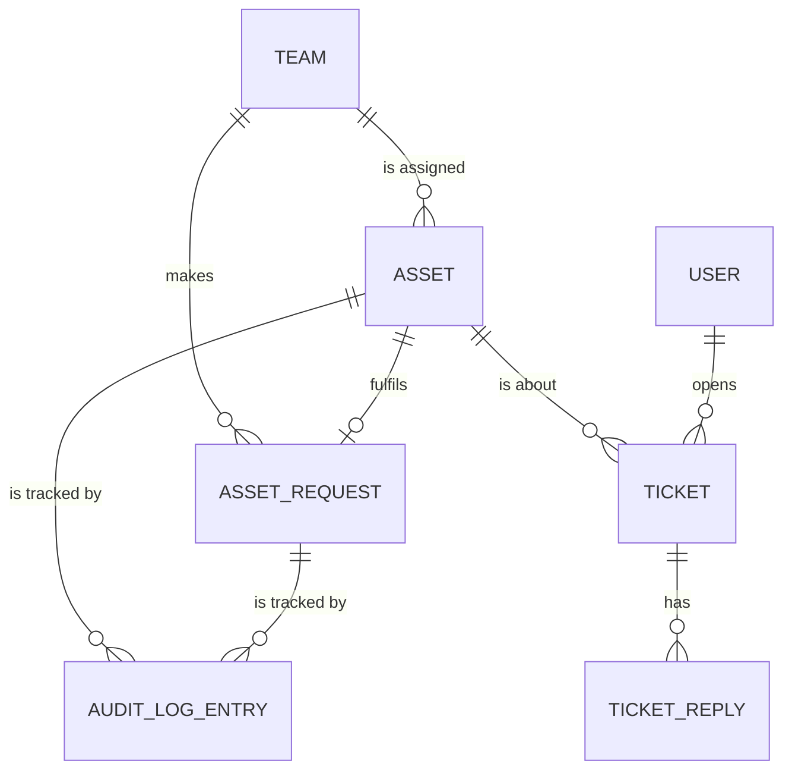

# spec.md — Resource Allocation & Help Desk Hub (Domain 2)

Items marked **[Assumption]** are design decisions where the project description leaves room for interpretation.

## 1. Overview

The Resource Allocation & Help Desk Hub is one backend service of the Project Portal (PP). It manages project assets that student teams need — software license keys and cloud credit vouchers — and gives teams a simple help desk for problems with those assets.

What it does:
- Instructors add assets to a shared pool
- Teams request assets; instructors approve or deny
- Approved assets are assigned to the team; the team marks them redeemed
- Every change to an asset or request is written to an audit log ("tracking parameters")
- Teams open help desk tickets about their assets; help desk staff reply, close, revoke or replace

**[Assumption]** "Logging tracking parameters" is read as: a record of which asset went to which team, when, by whom, and its status.

## 2. Tech stack

- C# / ASP.NET Core Web API (.NET 10)
- PostgreSQL 18
- Entity Framework Core (Npgsql provider)
- Docker + docker-compose (api + db containers)
- JSON REST API, OpenAPI/Swagger docs

## 3. Roles

| Role | Can do |
|---|---|
| Instructor | Add assets, view all assets, approve/deny requests, view audit log |
| Student (team member) | View their team's assets, request assets, mark assets redeemed, open and view tickets |
| Help desk staff | View and reply to tickets, close tickets, revoke assets, assign replacements |

**[Assumption]** Users, courses and teams are owned by other campus systems. Per project rules (no cross-service calls), they are loaded from local static mock data (Section 7), not managed by this service.

**[Assumption]** "Course groups" in the project description are represented by each team's `courseId`. There is no separate course-group entity.

**[Assumption]** Login is out of scope for this version. The caller is identified by an `X-User-Id` request header that matches a mock user.

## 4. Asset lifecycle

```
available ──(request approved)──> assigned ──(team redeems)──> redeemed
     │                                │                            │
     └────────────(staff revokes)─────┴────────────────────────────┴──> revoked
```

| Status | Meaning |
|---|---|
| available | In the pool, not given to any team |
| assigned | Given to a team, not yet used |
| redeemed | Team has used it (activated key / applied voucher) |
| revoked | Taken back by staff; cannot be used |

Request statuses: `pending`, `approved`, `denied`
Ticket statuses: `open`, `closed`

### Business rules

| # | Rule |
|---|---|
| R1 | **Approval matching:** approving a request assigns the oldest `available` asset whose `type` equals the request's `assetType` and whose `name` exactly equals the request's `assetName`. If none exists, return `409` and leave the request `pending`. |
| R2 | Denying a request sets it to `denied` and stores the reason. No asset changes. |
| R3 | Only a `pending` request can be approved or denied. Otherwise `409`. |
| R4 | Only an `assigned` asset can be redeemed. Otherwise `409`. |
| R5 | Any asset except a `revoked` one can be revoked. Revoking clears nothing else; `teamId` is kept for history. |
| R6 | **Replace:** revokes the asset, then assigns the oldest `available` asset with the same `type` and `name` to the same team. If none exists, return `409` and change nothing. |
| R7 | A ticket can only be opened for an asset currently held by the caller's team (`assigned` or `redeemed`). Otherwise `409`. |
| R8 | Replies can't be added to a `closed` ticket. Otherwise `409`. |
| R9 | Asset `code` must be unique. Adding a duplicate returns `409`. |
| R10 | Every asset and request change writes at least one audit log entry (Section 5). Approve writes `request_approved` + `asset_assigned`. Replace writes `asset_revoked` on the old asset and `asset_replaced` on the new asset, with the old asset id in `details`. |
| R11 | Every request must include an `X-User-Id` header matching a mock user. If missing or unknown, return `400`. |

## 5. Data model

### Entity relationships



TEAM and USER come from mock data (Section 7). The tables below are stored in PostgreSQL.

### assets
| Column | Type | Notes |
|---|---|---|
| id | uuid | PK |
| type | text | `license_key` or `cloud_voucher` |
| name | text | e.g. "JetBrains All Products", "AWS Credits" |
| provider | text | e.g. JetBrains, AWS, Azure |
| code | text | The key or voucher code. Unique |
| value_usd | numeric(10,2) | Vouchers only; null for license keys |
| status | text | available / assigned / redeemed / revoked |
| team_id | text | null when available |
| created_at | timestamptz | |
| updated_at | timestamptz | |

### asset_requests
| Column | Type | Notes |
|---|---|---|
| id | uuid | PK |
| team_id | text | Requesting team |
| requested_by | text | User id |
| asset_type | text | license_key / cloud_voucher |
| asset_name | text | What they want, e.g. "AWS Credits" |
| reason | text | Free text |
| status | text | pending / approved / denied |
| decided_by | text | Instructor user id, null while pending |
| deny_reason | text | Set when denied |
| asset_id | uuid | FK → assets.id, set when approved |
| created_at | timestamptz | |
| decided_at | timestamptz | |

### audit_log
| Column | Type | Notes |
|---|---|---|
| id | bigserial | PK |
| asset_id | uuid | FK → assets.id. Null for request-only events |
| request_id | uuid | FK → asset_requests.id. Null for asset-only events |
| action | text | asset_created / asset_assigned / asset_redeemed / asset_revoked / asset_replaced / request_created / request_approved / request_denied |
| team_id | text | Team involved, if any |
| performed_by | text | User id |
| details | text | Optional note |
| created_at | timestamptz | |

### tickets
| Column | Type | Notes |
|---|---|---|
| id | uuid | PK |
| asset_id | uuid | FK → assets.id |
| team_id | text | |
| opened_by | text | User id |
| subject | text | |
| description | text | |
| status | text | open / closed |
| created_at | timestamptz | |
| closed_at | timestamptz | |

### ticket_replies
| Column | Type | Notes |
|---|---|---|
| id | uuid | PK |
| ticket_id | uuid | FK → tickets.id |
| author_id | text | User id |
| message | text | |
| created_at | timestamptz | |

## 6. REST endpoints

Base path: `/api/v1`. All bodies are JSON, field names in camelCase. Caller identified by `X-User-Id` header (Section 3).

### Assets
| Method | Path | Who | Body | Returns |
|---|---|---|---|---|
| GET | /assets | Instructor | — | `200` Page of Asset. Filters: `status`, `type`, `teamId` |
| POST | /assets | Instructor | CreateAsset | `201` Asset |
| GET | /assets/{id} | Instructor, owning team | — | `200` Asset |
| GET | /teams/{teamId}/assets | Team members, instructor | — | `200` Page of Asset |
| POST | /assets/{id}/redeem | Owning team | — | `200` Asset (R4) |
| POST | /assets/{id}/revoke | Help desk | RevokeAsset | `200` Asset (R5) |
| POST | /assets/{id}/replace | Help desk | RevokeAsset | `200` Asset — the new one (R6) |
| GET | /assets/{id}/audit | Instructor | — | `200` Page of AuditLogEntry |

### Requests
| Method | Path | Who | Body | Returns |
|---|---|---|---|---|
| POST | /requests | Student | CreateRequest | `201` AssetRequest |
| GET | /requests | Instructor | — | `200` Page of AssetRequest. Filter: `status` |
| GET | /teams/{teamId}/requests | Team members | — | `200` Page of AssetRequest |
| POST | /requests/{id}/approve | Instructor | — | `200` AssetRequest with `assetId` set (R1, R3) |
| POST | /requests/{id}/deny | Instructor | DenyRequest | `200` AssetRequest (R2, R3) |

### Help desk
| Method | Path | Who | Body | Returns |
|---|---|---|---|---|
| POST | /tickets | Student | CreateTicket | `201` Ticket (R7) |
| GET | /tickets | Help desk | — | `200` Page of Ticket. Filter: `status` |
| GET | /teams/{teamId}/tickets | Team members | — | `200` Page of Ticket |
| GET | /tickets/{id} | Help desk, owning team | — | `200` Ticket with `replies` |
| POST | /tickets/{id}/replies | Help desk, owning team | CreateReply | `201` TicketReply (R8) |
| POST | /tickets/{id}/close | Help desk | — | `200` Ticket |

### Other
| Method | Path | Who | Returns |
|---|---|---|---|
| GET | /health | Anyone | `200` `{ "status": "ok" }` |
| GET | /audit | Instructor | `200` Page of AuditLogEntry. Filters: `teamId`, `action` |

### Paging
List endpoints accept `page` (default 1) and `pageSize` (default 20, max 100) and return:
```json
{ "items": [ ], "page": 1, "pageSize": 20, "totalCount": 42 }
```

## 6a. Schemas

Types: `string`, `number`, `uuid` (string), `datetime` (ISO 8601 UTC string), `enum`. "Req" = required in request bodies.

### Request bodies

**CreateAsset**
| Field | Type | Req | Notes |
|---|---|---|---|
| type | enum `license_key` \| `cloud_voucher` | yes | |
| name | string | yes | |
| provider | string | yes | |
| code | string | yes | Unique (R9) |
| valueUsd | number | yes for vouchers | Must be null/omitted for license keys |

**CreateRequest**
| Field | Type | Req | Notes |
|---|---|---|---|
| teamId | string | yes | Mock team id |
| assetType | enum `license_key` \| `cloud_voucher` | yes | |
| assetName | string | yes | Matched exactly against asset `name` (R1) |
| reason | string | no | |

**DenyRequest**
| Field | Type | Req |
|---|---|---|
| reason | string | yes |

**RevokeAsset** (revoke and replace)
| Field | Type | Req |
|---|---|---|
| reason | string | no |

**CreateTicket**
| Field | Type | Req |
|---|---|---|
| assetId | uuid | yes |
| subject | string | yes |
| description | string | yes |

**CreateReply**
| Field | Type | Req |
|---|---|---|
| message | string | yes |

### Response objects

**Asset**
| Field | Type | Notes |
|---|---|---|
| id | uuid | |
| type | enum | license_key / cloud_voucher |
| name | string | |
| provider | string | |
| code | string | |
| valueUsd | number \| null | |
| status | enum | available / assigned / redeemed / revoked |
| teamId | string \| null | |
| createdAt | datetime | |
| updatedAt | datetime | |

**AssetRequest**
| Field | Type | Notes |
|---|---|---|
| id | uuid | |
| teamId | string | |
| requestedBy | string | User id (from `X-User-Id`) |
| assetType | enum | |
| assetName | string | |
| reason | string \| null | |
| status | enum | pending / approved / denied |
| decidedBy | string \| null | |
| denyReason | string \| null | |
| assetId | uuid \| null | Set when approved |
| createdAt | datetime | |
| decidedAt | datetime \| null | |

**Ticket**
| Field | Type | Notes |
|---|---|---|
| id | uuid | |
| assetId | uuid | |
| teamId | string | |
| openedBy | string | User id |
| subject | string | |
| description | string | |
| status | enum | open / closed |
| createdAt | datetime | |
| closedAt | datetime \| null | |
| replies | TicketReply[] | Only on `GET /tickets/{id}` |

**TicketReply**
| Field | Type |
|---|---|
| id | uuid |
| ticketId | uuid |
| authorId | string |
| message | string |
| createdAt | datetime |

**AuditLogEntry**
| Field | Type | Notes |
|---|---|---|
| id | number | |
| assetId | uuid \| null | |
| requestId | uuid \| null | |
| action | enum | See audit_log table |
| teamId | string \| null | |
| performedBy | string | User id |
| details | string \| null | |
| createdAt | datetime | |

### Example: request and approve

**POST /requests** (header `X-User-Id: u-stu-04`)
```json
{
  "teamId": "team-cs763-03",
  "assetType": "license_key",
  "assetName": "JetBrains All Products",
  "reason": "Need Rider for backend work"
}
```
`201 Created`
```json
{
  "id": "a3e0c7d2-1f4b-4e8a-9c21-7b5d6e4f3a90",
  "teamId": "team-cs763-03",
  "requestedBy": "u-stu-04",
  "assetType": "license_key",
  "assetName": "JetBrains All Products",
  "reason": "Need Rider for backend work",
  "status": "pending",
  "decidedBy": null,
  "denyReason": null,
  "assetId": null,
  "createdAt": "2026-11-02T15:00:00Z",
  "decidedAt": null
}
```

**POST /requests/a3e0c7d2-.../approve** (header `X-User-Id: u-inst-01`)
`200 OK` — same object with `"status": "approved"`, `"decidedBy": "u-inst-01"`, `"assetId"` set, `"decidedAt"` set. The asset becomes `assigned` to `team-cs763-03`. Two audit entries are written: `request_approved` and `asset_assigned`.

**POST /assets** (header `X-User-Id: u-inst-01`)
```json
{
  "type": "cloud_voucher",
  "name": "AWS Credits",
  "provider": "AWS",
  "code": "AWS-EDU-7F3K-91QZ",
  "valueUsd": 100.00
}
```
`201 Created` — Asset with `"status": "available"`, `"teamId": null`.

### Error format
All errors use one shape:
```json
{ "error": "not_found", "message": "Asset not found" }
```

| Code | When |
|---|---|
| 400 | Missing or invalid fields; missing or unknown `X-User-Id` (R11) |
| 404 | Item doesn't exist |
| 409 | Breaks a business rule R1–R9 (e.g. redeem a revoked asset, approve when no matching asset is available, duplicate code) |

## 7. Static mock data

Loaded at startup from `mock-data/*.json`. Read-only.

**users.json**
```json
[
  { "id": "u-inst-01", "name": "Dr. Rivera", "role": "instructor" },
  { "id": "u-help-01", "name": "Sam Ortiz", "role": "helpdesk" },
  { "id": "u-stu-01", "name": "Ava Chen", "role": "student", "teamId": "team-cs763-01" },
  { "id": "u-stu-02", "name": "Ben Patel", "role": "student", "teamId": "team-cs763-01" },
  { "id": "u-stu-03", "name": "Cara Diaz", "role": "student", "teamId": "team-cs763-02" },
  { "id": "u-stu-04", "name": "Dev Shah", "role": "student", "teamId": "team-cs763-03" }
]
```

**courses.json**
```json
[ { "id": "CS763", "name": "Secure Software Development", "term": "2026 Fall 2" } ]
```

**teams.json**
```json
[
  { "id": "team-cs763-01", "name": "Team Alpha", "courseId": "CS763" },
  { "id": "team-cs763-02", "name": "Team Beta", "courseId": "CS763" },
  { "id": "team-cs763-03", "name": "Team Gamma", "courseId": "CS763" }
]
```

**Seed assets** (inserted into PostgreSQL on first run, codes are fake):

| Type | Name | Provider | Value | Count | Statuses |
|---|---|---|---|---|---|
| license_key | JetBrains All Products | JetBrains | — | 3 | 2 available, 1 assigned to team-cs763-01 |
| license_key | GitHub Copilot | GitHub | — | 3 | 1 available, 1 assigned to team-cs763-02, 1 redeemed by team-cs763-01 |
| cloud_voucher | AWS Credits | AWS | $100 | 3 | 2 available, 1 redeemed by team-cs763-03 |
| cloud_voucher | Azure Credits | Azure | $50 | 3 | 1 available, 1 assigned to team-cs763-03, 1 revoked (was team-cs763-02) |

Request `assetName` values must use these exact names to match (R1).

## 8. Deployment

- `docker-compose.yml` runs two containers: `api` (ASP.NET Core) and `db` (PostgreSQL)
- Multi-stage Dockerfile: build with .NET SDK image, run on ASP.NET runtime image
- Database schema created by EF Core migrations at startup
- API listens on port 8080 inside the container

## 9. Out of scope (this version)

- Real login/identity provider (see Section 3 assumption)
- Asset expiry dates and usage tracking
- Email/notifications
- Calls to other Project Portal services

Security requirements (authentication, authorization, input validation, protection of asset codes) will be added in later phases of the project.
