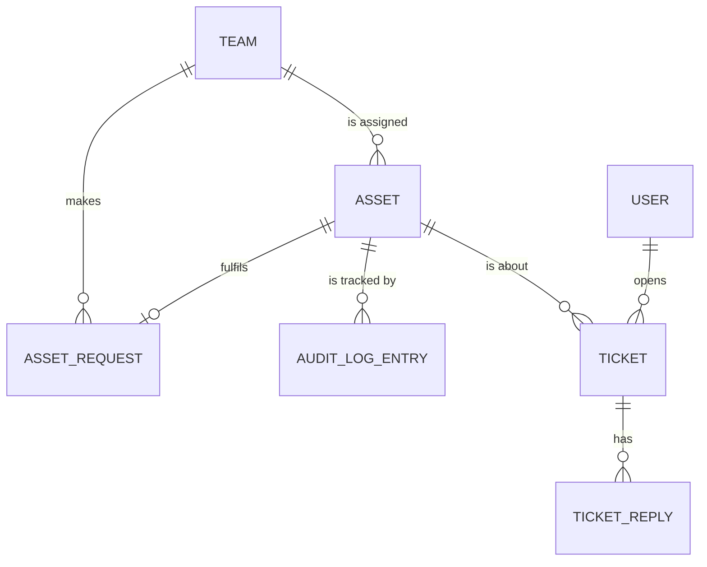

# spec.md — Resource Allocation & Help Desk Hub (Domain 2)

> DRAFT for review. Items marked **[Assumption]** are design choices I can change.

## 1. Overview

The Resource Allocation & Help Desk Hub is one backend service of the Project Portal (PP). It manages project assets that student teams need — software license keys and cloud credit vouchers — and gives teams a simple help desk for problems with those assets.

What it does:
- Instructors add assets to a shared pool
- Teams request assets; instructors approve or deny
- Approved assets are assigned to the team; the team marks them redeemed
- Every change to an asset is written to an audit log ("tracking parameters")
- Teams open help desk tickets about their assets; help desk staff reply, close, revoke or replace

**[Assumption]** "Logging tracking parameters" is read as: a record of which asset went to which team, when, by whom, and its status.

## 2. Tech stack

- C# / ASP.NET Core Web API (.NET 10)
- PostgreSQL 17
- Entity Framework Core (Npgsql provider)
- Docker + docker-compose (api + db containers)
- JSON REST API, OpenAPI/Swagger docs

## 3. Roles

| Role | Can do |
|---|---|
| Instructor | Add assets, view all assets, approve/deny requests, view audit log |
| Student (team member) | View their team's assets, request assets, mark assets redeemed, open and view tickets |
| Help desk staff | View and reply to tickets, close tickets, revoke assets, assign replacements |

**[Assumption]** Users, courses and teams are owned by other campus systems. Per project rules (no cross-service calls), they are loaded from local static mock data (Section 7), not managed by this service.

**[Assumption]** Login is out of scope for this version. The caller is identified by an `X-User-Id` request header that matches a mock user.

## 4. Asset lifecycle

```
available ──(request approved)──> assigned ──(team redeems)──> redeemed
     │                                │                            │
     └────────────(staff revokes)─────┴────────────────────────────┴──> revoked
```

| Status | Meaning |
|---|---|
| available | In the pool, not given to any team |
| assigned | Given to a team, not yet used |
| redeemed | Team has used it (activated key / applied voucher) |
| revoked | Taken back by staff; cannot be used |

Request statuses: `pending`, `approved`, `denied`
Ticket statuses: `open`, `closed`

## 5. Data model

### Entity relationships



TEAM and USER come from mock data (Section 7). The tables below are stored in PostgreSQL.

### assets
| Column | Type | Notes |
|---|---|---|
| id | uuid | PK |
| type | text | `license_key` or `cloud_voucher` |
| name | text | e.g. "JetBrains All Products", "AWS Credits" |
| provider | text | e.g. JetBrains, AWS, Azure |
| code | text | The key or voucher code |
| value_usd | numeric(10,2) | Vouchers only; null for license keys |
| status | text | available / assigned / redeemed / revoked |
| team_id | text | null when available |
| created_at | timestamptz | |
| updated_at | timestamptz | |

### asset_requests
| Column | Type | Notes |
|---|---|---|
| id | uuid | PK |
| team_id | text | Requesting team |
| requested_by | text | User id |
| asset_type | text | license_key / cloud_voucher |
| asset_name | text | What they want, e.g. "AWS Credits" |
| reason | text | Free text |
| status | text | pending / approved / denied |
| decided_by | text | Instructor user id, null while pending |
| asset_id | uuid | FK → assets.id, set when approved |
| created_at | timestamptz | |
| decided_at | timestamptz | |

### audit_log
| Column | Type | Notes |
|---|---|---|
| id | bigserial | PK |
| asset_id | uuid | FK → assets.id |
| action | text | created / assigned / redeemed / revoked / replaced |
| team_id | text | Team involved, if any |
| performed_by | text | User id |
| details | text | Optional note |
| created_at | timestamptz | |

### tickets
| Column | Type | Notes |
|---|---|---|
| id | uuid | PK |
| asset_id | uuid | FK → assets.id |
| team_id | text | |
| opened_by | text | User id |
| subject | text | |
| description | text | |
| status | text | open / closed |
| created_at | timestamptz | |
| closed_at | timestamptz | |

### ticket_replies
| Column | Type | Notes |
|---|---|---|
| id | uuid | PK |
| ticket_id | uuid | FK → tickets.id |
| author_id | text | User id |
| message | text | |
| created_at | timestamptz | |

## 6. REST endpoints

Base path: `/api/v1`

### Assets
| Method | Path | Who | Description |
|---|---|---|---|
| GET | /assets | Instructor | List all assets. Filters: `status`, `type`, `teamId` |
| POST | /assets | Instructor | Add an asset to the pool |
| GET | /assets/{id} | Instructor, owning team | Get one asset |
| GET | /teams/{teamId}/assets | Team members, instructor | List a team's assets |
| POST | /assets/{id}/redeem | Owning team | Mark assigned asset as redeemed |
| POST | /assets/{id}/revoke | Help desk | Revoke an asset |
| POST | /assets/{id}/replace | Help desk | Revoke and assign a new available asset of the same type to the same team |
| GET | /assets/{id}/audit | Instructor | Audit log for one asset |

### Requests
| Method | Path | Who | Description |
|---|---|---|---|
| POST | /requests | Student | Request an asset for their team |
| GET | /requests | Instructor | List requests. Filter: `status` |
| GET | /teams/{teamId}/requests | Team members | List a team's requests |
| POST | /requests/{id}/approve | Instructor | Approve; assigns an available matching asset |
| POST | /requests/{id}/deny | Instructor | Deny with a reason |

### Help desk
| Method | Path | Who | Description |
|---|---|---|---|
| POST | /tickets | Student | Open a ticket about a team asset |
| GET | /tickets | Help desk | List tickets. Filter: `status` |
| GET | /teams/{teamId}/tickets | Team members | List a team's tickets |
| GET | /tickets/{id} | Help desk, owning team | Ticket with replies |
| POST | /tickets/{id}/replies | Help desk, owning team | Add a reply |
| POST | /tickets/{id}/close | Help desk | Close a ticket |

### Other
| Method | Path | Description |
|---|---|---|
| GET | /health | Health check for Docker/CI |
| GET | /audit | Full audit log (instructor). Filters: `teamId`, `action` |

### Example payloads

**POST /assets**
```json
{
  "type": "cloud_voucher",
  "name": "AWS Credits",
  "provider": "AWS",
  "code": "AWS-EDU-7F3K-91QZ",
  "valueUsd": 100.00
}
```
Response `201 Created`:
```json
{
  "id": "6f1c2a9e-4b7d-4c1e-9a55-2f0d3b8e1a10",
  "type": "cloud_voucher",
  "name": "AWS Credits",
  "provider": "AWS",
  "code": "AWS-EDU-7F3K-91QZ",
  "valueUsd": 100.00,
  "status": "available",
  "teamId": null,
  "createdAt": "2026-11-02T14:00:00Z",
  "updatedAt": "2026-11-02T14:00:00Z"
}
```

**POST /requests**
```json
{
  "teamId": "team-cs763-03",
  "assetType": "license_key",
  "assetName": "JetBrains All Products",
  "reason": "Need Rider for backend work"
}
```

**POST /requests/{id}/deny**
```json
{ "reason": "No licenses left this term" }
```

**POST /tickets**
```json
{
  "assetId": "6f1c2a9e-4b7d-4c1e-9a55-2f0d3b8e1a10",
  "subject": "Voucher rejected",
  "description": "AWS says the code is already used"
}
```

**POST /tickets/{id}/replies**
```json
{ "message": "Revoked and replaced, check your team's assets" }
```

### Error format
All errors use one shape:
```json
{ "error": "not_found", "message": "Asset not found" }
```

| Code | When |
|---|---|
| 400 | Missing or invalid fields |
| 404 | Item doesn't exist |
| 409 | Invalid status change (e.g. redeem a revoked asset, approve when no asset is available) |

## 7. Static mock data

Loaded at startup from `mock-data/*.json`. Read-only.

**users.json**
```json
[
  { "id": "u-inst-01", "name": "Dr. Rivera", "role": "instructor" },
  { "id": "u-help-01", "name": "Sam Ortiz", "role": "helpdesk" },
  { "id": "u-stu-01", "name": "Ava Chen", "role": "student", "teamId": "team-cs763-01" },
  { "id": "u-stu-02", "name": "Ben Patel", "role": "student", "teamId": "team-cs763-01" },
  { "id": "u-stu-03", "name": "Cara Diaz", "role": "student", "teamId": "team-cs763-02" },
  { "id": "u-stu-04", "name": "Dev Shah", "role": "student", "teamId": "team-cs763-03" }
]
```

**courses.json**
```json
[ { "id": "CS763", "name": "Secure Software Development", "term": "2026 Fall 2" } ]
```

**teams.json**
```json
[
  { "id": "team-cs763-01", "name": "Team Alpha", "courseId": "CS763" },
  { "id": "team-cs763-02", "name": "Team Beta", "courseId": "CS763" },
  { "id": "team-cs763-03", "name": "Team Gamma", "courseId": "CS763" }
]
```

**Seed assets** (inserted into PostgreSQL on first run): 6 license keys and 6 cloud vouchers, mixed statuses, so every endpoint has data to return.

## 8. Deployment

- `docker-compose.yml` runs two containers: `api` (ASP.NET Core) and `db` (PostgreSQL)
- Multi-stage Dockerfile: build with .NET SDK image, run on ASP.NET runtime image
- Database schema created by EF Core migrations at startup
- API listens on port 8080 inside the container

## 9. Out of scope (this version)

- Real login/identity provider (see Section 3 assumption)
- Asset expiry dates and usage tracking
- Email/notifications
- Calls to other Project Portal services

Security requirements (authentication, authorization, input validation, protection of asset codes) will be added in later phases of the project.
